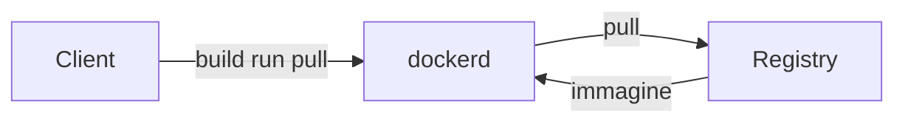

# Lezione 16.2 Docker - Containerization for Software Engineers

> [!info] Contesto
> Lezione **introduttiva** sul tema containerization: serve a motivare l'utilità di Docker, non è contenuto essenziale del corso.

## Tendenze del settore software

Il settore del software è passato da un modello monolitico a servizi disaccoppiati distribuiti su molti ambienti.

- **Prima**: software **monolitico**, cicli di sviluppo lunghi, un solo ambiente di destinazione, scalata lenta.
- **Ora**: servizi **disaccoppiati**, miglioramenti rapidi e iterativi, molti ambienti di destinazione, scalata rapida necessaria.

## La complessità dei deployment

Ogni servizio indipendente combina molti stack (linguaggi, framework, database) e deve raggiungere molti ambienti (sviluppo, QA, staging, produzione on-premises o cloud, disaster recovery). Due domande definiscono la sfida: i servizi interagiscono correttamente tra loro? È possibile migrare senza intoppi tra gli ambienti?

> [!def] Matrix from Hell
> **Matrice** ottenuta incrociando gli N stack con gli M ambienti: prima dei container ogni cella è un punto interrogativo, cioè una combinazione stack-ambiente da configurare e verificare separatamente.

## L'analogia del trasporto merci

Il problema del software ricalca quello del trasporto merci prima degli anni Sessanta: molteplicità di merci che possono interagire tra loro e molteplicità di mezzi di trasporto e stoccaggio difficili da cambiare. I container da trasporto risolvono entrambe e hanno queste proprietà.

- **Standardizzati**: hanno tutti le stesse dimensioni.
- **Versatili**: possono essere caricati con praticamente qualsiasi merce.
- **Preparati dai responsabili della spedizione**, che garantiscono che dentro non avvengano interazioni indesiderate.
- **Sigillati** fino alla consegna finale e **uniformi durante il trasporto**, quindi facili da caricare, scaricare e impilare.

### Container per il codice

La stessa soluzione vale per il software: gli **stack** corrispondono alle merci, gli **ambienti hardware** ai mezzi di trasporto e stoccaggio.

## Container software

I container risolvono la «Matrix from Hell»: ogni combinazione stack-ambiente riceve lo stesso contenitore standardizzato. Separano inoltre le responsabilità tra chi sviluppa e chi gestisce l'esercizio.

- **Sviluppatori**: si curano solo di ciò che sta **dentro** il container; setup dell'ambiente di sviluppo semplificato; nessun conflitto di librerie e dipendenze; *build once, run anywhere*.
- **Operations**: si curano solo di ciò che sta **fuori** dal container; ogni container si gestisce allo stesso modo; gestione del ciclo di vita semplificata; *configure once, run anything*.

> [!warning] Limiti della portabilità
> La portabilità dei container vale entro la **stessa architettura e lo stesso kernel**: *build once, run anywhere* significa ovunque con architettura uguale e kernel Linux moderno; *configure once, run anything* significa qualsiasi software costruito sulla stessa architettura e kernel.

## Macchine virtuali vs container

Le macchine virtuali risolvono gli stessi problemi dei container, ma sono meno leggere: ogni VM porta con sé un **Guest OS** completo per ogni applicazione, mentre il container condivide il sistema operativo dell'host. I container consentono deployment, riavvio ecc. **significativamente più rapidi**.

| Strato | Macchine virtuali | Container |
| --- | --- | --- |
| Per ogni app | App + Bins/Libs + Guest OS | App + Bins/Libs |
| Strato condiviso | Hypervisor | Container engine |
| Base | Infrastructure | Operating System + Infrastructure |

## Docker

### Docker come container engine

> [!aside]
> 
> > [!def] Docker
> > **Container engine** de facto standard per la containerizzazione del software, progetto nato nel 2013.
> 
> ---
> 
> ![[Lezione 16-1793204520758.png|50]]


Esistono alternative: LXD, BuildKit, Buildah, Podman.

### Architettura di Docker

L'architettura separa il client, l'host Docker e il registry delle immagini.

- **Client**: tool a riga di comando o Docker Desktop GUI; invia al daemon comandi come `build`, `pull`, `run`.
- **Docker host**: ospita il **daemon** (`dockerd`), che costruisce le immagini ed esegue i container.
- **Registry**: archivio di immagini (DockerHub, JFrog, Quay.io) da cui il daemon scarica le immagini.



### Immagini Docker

> [!def] Immagine Docker
> **Template portatile e in sola lettura** che contiene tutte le istruzioni per creare un container.

> [!aside]
> Un'immagine si ottiene in tre modi.
> 
> - **Caricata** da un file archivio tar.
> - **Scaricata** da un registry.
> - **Costruita** estendendo un'immagine esistente con una lista di istruzioni scritte in un Dockerfile.
> 
> ---
> 
> ![[3fed1cdb228ca6c5727835e7be749a535b4d369d14b4f59412426ac563a39ef8.png|100]]

### Dockerfile

> [!def] Dockerfile
> **Insieme di comandi** per assemblare un'immagine: si parte **`FROM`** un'immagine base e si usano **`RUN`** (comandi), **`COPY`** (file), **`EXPOSE`** (porte), **`ENV`** (variabili d'ambiente) e **`CMD`** (comando di default all'avvio).

```dockerfile
FROM ubuntu:20.04
RUN apt update -qq && apt install -y -q fortune cowsay
COPY ./file.txt /home/file.txt
CMD bash
```

La CLI gestisce il ciclo di vita: `docker pull` scarica un'immagine, `docker run -it --name <nome> <immagine>` crea e avvia un container, `docker start`/`docker attach`/`docker exec` lo riavviano e vi eseguono comandi, `docker kill` e `docker rm` lo terminano ed eliminano, `docker build -t <nome> .` costruisce un'immagine dal Dockerfile della directory corrente.

## Applicazioni container-native

> [!def] Software container-native
> **Software** per cui i container sono le unità di infrastruttura di primo livello (non server o VM), progettato per i container fin dall'inizio.

Come esempio di uso di Docker come sviluppatori, la lezione costruisce una web app a microservizi: un **frontend** (pagina web con un po' di JavaScript) e due servizi backend che comunicano via **HTTP** — un **fortune service** (Nodejs ed Express) che risponde a GET `/fortune`, e un **uppercase service** (Python e Flask) che risponde a POST `/uppercase` e GET `/uppercase-fortune`, quest'ultimo ottenendo il fortune dal fortune service e rendendolo maiuscolo. Ogni componente ha un proprio Dockerfile, che estende l'immagine base del linguaggio (`node:14`, `python:3.8`, `nginx:latest`), copia i file del servizio, installa le dipendenze ed espone la porta del container.

![[4cad402a5e752becc4b9cfb39de98a5c19ad52e48baba9442159ea43de52220a.jpg|400]]

> [!def] Docker Compose
> **Strumento di orchestrazione** che definisce e avvia applicazioni multi-container a partire da un unico file YAML, con una direttiva per ogni servizio.

Nel file compose ogni servizio dichiara la propria directory di build (`build`), l'ordine di avvio (`depends_on`), il mapping delle porte `host:container` (`ports`, es. `"8080:80"`), le variabili d'ambiente (`environment`, grazie alle quali un servizio raggiunge un altro tramite il nome del servizio) e il proprio nome (`container_name`). Con `docker-compose -p "nome-progetto" up -d` compose costruisce le immagini, crea la rete di default del progetto e avvia i container di tutti i servizi.