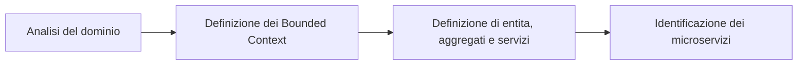

# Lezione 19-20 Modern Software Architectures

## Il ciclo di vita di sviluppo del software

Lo sviluppo di un sistema software articolato attraversa fasi successive.

1. **Ingegneria dei requisiti**: i requisiti si raccolgono tramite interviste con gli stakeholder, *personas*, storie e scenari; si specificano con casi d'uso e linguaggio naturale.
2. **Progettazione del sistema e della UI**: i requisiti vengono allocati ai sottosistemi software e i sottosistemi alle risorse hardware (pattern architetturali); si definiscono poi gli oggetti necessari a realizzare ogni sottosistema (design pattern, ingegneria dell'usabilità, *wireframe* ad alta fedeltà).
3. **Implementazione**: ogni sottosistema viene realizzato con codice sorgente e altri artefatti, curando *clean code*, framework, ORM e qualità del software.
4. **Testing**: si verifica che il software soddisfi i clienti, tramite modelli di dominio, ispezioni del codice, testing funzionale (unitario, di integrazione, di sistema) e test di usabilità.
5. **Esercizio e manutenzione**: il sistema entra in uso pratico; la manutenzione serve a correggere errori non scoperti nelle fasi precedenti e ad adattare il software a cambiamenti nei requisiti o nel suo ambiente.

## Architettura del sistema software

> [!def] Architettura del sistema software
> **Insieme delle decisioni di progetto principali** assunte sul sistema: un progetto di riferimento (*blueprint*) per la sua costruzione ed evoluzione. Queste decisioni hanno un impatto significativo su struttura, comportamento, interazioni e proprietà non funzionali del sistema.

«Principale» implica un grado di importanza superiore, che riconosce a una decisione di progetto uno «stato architetturale»; non esiste però un modo oggettivo per stabilire quali decisioni siano principali.

> «Architecture is about the important stuff. Whatever that is».

Pensare da architetti significa decidere cosa è importante e spendere energia per tenere quegli elementi in buono stato. Per diventare architetto, uno sviluppatore deve saper riconoscere gli elementi importanti, cioè quelli che, se non controllati, produrrebbero problemi seri.

L'architettura riguarda ciò che è difficile cambiare in seguito: scegliere tra MariaDB e MySQL non è una decisione architetturale, mentre scegliere tra un database relazionale e uno NoSQL lo è.

### Perché l'architettura è importante

L'architettura è un tema ostico per clienti e utenti perché non è direttamente percepibile; ha però un impatto significativo su struttura, comportamento, interazioni e proprietà non funzionali del sistema.

Una scarsa architettura produce sistemi molto più difficili da realizzare ed evolvere, con impatti su costi e consegna di nuove funzionalità. L'**alta qualità interna** costa di più all'inizio, ma ripaga nel lungo periodo.

![[0ab277368569fdb7bf483b86dd948f9b360d78b5d2ad3b1c61928a5872c8f730.png|350]]

### Proprietà influenzate dall'architettura

Le proprietà non funzionali influenzate dall'architettura sono **scalabilità**, **disponibilità**, **consistenza**, **performance**, **latenza** e **throughput**.

## Scalabilità

> [!def] Scalabilità
> **Proprietà** di un servizio le cui prestazioni crescono in modo proporzionale alle risorse aggiunte.

Aumentare le prestazioni significa in genere servire più unità di lavoro, ma anche saper gestire unità di lavoro più grandi, come nella crescita dei dataset.

> [!info] Performance e scalabilità
> - **Problema di performance**: il sistema è lento già per un singolo utente.
> - **Problema di scalabilità**: il sistema è veloce per un singolo utente, ma lento sotto carico pesante.

La scalabilità è anche una questione di denaro: a parità di risorse pagate, cresce il volume servito (richieste gestite, transazioni, utenti concorrenti...).

### Orizzontale, verticale e diagonale

Esistono tre strategie per servire più unità di lavoro.

> [!aside]
> - **Scalabilità orizzontale**: aumenta il numero di nodi di calcolo.
> 
> ---
> 
> ![[64d0f7efa6bcfc6df5e52483593a9862a8e514d5147e48de72fb4fdeb71bb153.png|50]]
> 

> [!aside]
> - **Scalabilità verticale**: aumenta la potenza di calcolo del nodo.
> 
> ---
> 
> ![[23c976ce8e7811e4c27f13f8e12c74f2a2dfe6f47bbbfbbe69261c51b4d4a921.png|50]]
> 

> [!aside]
> - **Scalabilità diagonale**: aumenta insieme numero e potenza dei nodi.
> 
> ---
> 
> ![[838908feb906809fa575b40b713d7b9ffe685feb8473c1b444ffeb2c8c143e4c.png|50]]
> 

### Load balancing

Scalando orizzontalmente (o diagonalmente) è necessario un componente dedicato che distribuisca le richieste in arrivo ai nodi di calcolo.

> [!def] Load Balancer
> **Componente** che distribuisce le richieste in arrivo ai nodi di calcolo quando si scala orizzontalmente o diagonalmente.

Il Load Balancer instrada il traffico secondo strategie diverse: **random** (traffico diretto a un nodo casuale), **least loaded** (al nodo meno caricato), **round robin**, **Layer 4** (guarda i dettagli del livello di trasporto, es. indirizzo IP sorgente), **Layer 7** (guarda i dettagli del livello applicativo, es. cookie e sessioni).

![[b40f39e7ba1b9f65f69644546ebf56dbd8eb375e7df66fcce2005866f7a18c30.png|300]]

> [!warning] Limiti del load balancer
> Un load balancer può diventare un collo di bottiglia per le prestazioni, e un singolo load balancer è un singolo punto di guasto (*single point of failure*).

## Disponibilità

> [!def] Disponibilità
> **Proporzione di tempo** in cui un sistema o servizio è operativo e accessibile all'uso.

La disponibilità è cruciale per i sistemi la cui operatività continua è vitale: i sistemi *business-critical* (perdite finanziarie, danno reputazionale...) e quelli *safety-critical*.

Le cause di indisponibilità possono essere: problemi software (l'applicazione smette di rispondere), carichi eccessivi (risorse computazionali insufficienti), perdita della connessione di rete, guasti hardware.

### Quantificazione

La disponibilità si quantifica come percentuale di tempo di attività (*uptime*) ed è misurata in numero di 9: un servizio con disponibilità pari al 99,99% si dice avere «quattro 9».

| Numero di 9 | Disponibilità | Downtime accettabile in un anno |
|---|---|---|
| Uno | 90% | circa 36 giorni |
| Due | 99% | circa 3 giorni e 15 ore |
| Tre | 99,9% | circa 8 ore e 41 minuti |
| Quattro | 99,99% | circa 52 minuti |
| Cinque | 99,999% | circa 5 minuti |
| Sei | 99,9999% | circa 31 secondi |

### Fail-over

L'alta disponibilità si persegue con meccanismi di *fail-over*, in due varianti.

> [!aside]
> - **Fail-over attivo-passivo**: al guasto di un componente primario, un'istanza secondaria ne prende il lavoro; la secondaria è generalmente passiva e non fa alcun lavoro finché la primaria non fallisce.
> 
> ---
> 
> ![[Lezione 19-20-1792742963622.png|100]]

> [!aside]
> - **Fail-over attivo-attivo**: due o più istanze del componente esistono da subito e si dividono il lavoro (come nello scaling orizzontale); al guasto di una, le altre ne raccolgono anche la sua parte.
> 
> ---
> 
> ![[Lezione 19-20-1792742987903.png|100]]

> [!example]  Fault Tollerance
> Software e dei sistemi per garantire la tolleranza ai guasti
> ![[Lezione 19-20-1792742934556.png|200]]

### Osservabilità e monitoraggio

Con i meccanismi di fail-over, il downtime dipende da diversi fattori.

- Quanto in fretta si nota il guasto di un componente? Tipicamente lo si rileva tramite **heartbeat**: segnali o controlli periodici che verificano il funzionamento normale del sistema.
- Quanto tempo impiega l'istanza secondaria a partire? La secondaria può essere in standby «caldo» (*hot*) o «freddo» (*cold*); nel fail-over attivo-attivo le istanze secondarie sono già in esecuzione.

La **osservabilità** — il grado in cui si può capire cosa accade in un sistema software — è una caratteristica importante dell'architettura; per il monitoraggio si usano spesso soluzioni come OpenTelemetry.

## Dati e consistenza

Scalare orizzontalmente le istanze applicative è relativamente facile: basta un nuovo server con l'applicazione e un load balancer. La maggior parte delle applicazioni richiede però anche persistenza dei dati, e scalare i dati in un database relazionale non è altrettanto facile.

### Proprietà ACID

> [!def] ACID
> **Insieme di proprietà** delle transazioni nei database relazionali.
> - **Atomicità**: ogni transazione è tutto o niente.
> - **Consistenza**: ogni transazione porta il database da uno stato valido a un altro.
> - **Isolamento**: l'esecuzione concorrente di transazioni produce gli stessi risultati dell'esecuzione in serie.
> - **Durabilità**: una volta confermata, una transazione rimane tale.

### Scalare un RDBMS

Le proprietà ACID rendono impossibile scalare orizzontalmente un RDBMS in modo semplice. Le strade percorribili sono lo scaling verticale (più risorse di calcolo sullo stesso nodo) e tecniche specifiche di replica e partizionamento.

![[Lezione 19-20-1792744201866.png|200]]

#### Master-Slave

Più istanze dell'RDBMS: un **master** e uno o più **slave**. Il master serve letture e scritture, replicando ogni scrittura su ciascuno slave; gli slave agiscono da repliche in sola lettura. Se il master fallisce, il sistema può continuare a operare in sola lettura (uno slave può eventualmente essere promosso). L'approccio funziona bene con molte letture e poche scritture; la replica introduce un *overhead*.

![[c86882a30387c174bb7258e076b1f49be992cf034bb947d50804b31e7e2d9a67.png|300]]

#### Master-Master

Tutte le istanze sono master e servono sia letture che scritture: per ogni scrittura i master si coordinano e sincronizzano, mentre le letture sono gestite indipendentemente. Se un master fallisce, il sistema continua a operare con gli altri; la sincronizzazione introduce un *overhead*.

![[89483fa01f10f72e940dfe899beed38d504f18c16036845b159c2e253b25e56f.png|300]]

#### Federation

Un singolo grande database può essere suddiviso in più database per funzione (es. un database prodotti, uno utenti, uno ordini). Presenta alcuni limiti: non è efficace se lo schema include una tabella molto grande; rende più difficili i join; rende più difficile imporre vincoli tra tabelle diverse (es. chiavi esterne); può richiedere denormalizzazione.

#### Sharding

> [!aside]
> Lo **sharding** distribuisce i dati su più database in modo che ciascuno gestisca solo un sottoinsieme dei dati. Conseguenze: la logica applicativa diventa più complessa per gestire gli shard; gli shard possono diventare sbilanciati; i join sono difficili; imporre vincoli è più difficile.
> 
> ---
> 
> ![[3fd69e98f66a344556b2713ebc959905516a041f9019e8d7ace2aeced8ec00f2.png|200]]
> 

#### Denormalizzazione

La **denormalizzazione** cerca di migliorare le prestazioni in lettura a spese di parte delle prestazioni in scrittura e della perdita di normalizzazione: si scrivono copie ridondanti dei dati in più tabelle per evitare join costosi. Mantenere i dati consistenti può essere un problema; alcuni RDBMS come PostgreSQL supportano le **viste materializzate**, che si occupano di memorizzare le informazioni ridondanti e di mantenere coerenti le copie.

### Database NoSQL

I modelli di database NoSQL sono più scalabili, al costo di rinunciare alle vere transazioni ACID (e ad alcune prestazioni di interrogazione). Le loro proprietà si descrivono con l'acronimo BASE.

> [!def] BASE
> **Acronimo** delle proprietà dei database NoSQL.
> - **Basically Available**: il sistema garantisce la disponibilità.
> - **Soft state**: lo stato del sistema può cambiare nel tempo, anche senza input.
> - **Eventual consistency**: il sistema diventa consistente dopo un periodo di tempo, purché non riceva input durante quel periodo.

> [!def] Consistenza finale
> **Garanzia informale** per cui, se non vengono effettuati nuovi aggiornamenti a un dato, prima o poi tutti gli accessi a quel dato restituiranno l'ultimo valore aggiornato.

In un cluster NoSQL un aggiornamento si propaga progressivamente ai vari nodi, che per un certo tempo possono restituire valori diversi.

![[7bffaeeadbba625eee0f843477e5926fb63760d27740798f30da0616bd6dab3e.png|300]]

![[Lezione 19-20-1792743955311.png|300]]

Esistono diversi modelli di database NoSQL.

- **Key-value store** (Redis, Memcached): tipicamente operano in memoria.
- **Document store** (MongoDB): centrati su documenti (XML, JSON...) che contengono tutte le informazioni di un dato oggetto.
- **Graph database** (Neo4J): ogni nodo è un record e le relazioni tra record sono rappresentate come archi.
- **Vector database** (Milvus): specializzati nell'archiviazione e nel reperimento di grandi vettori, spesso provenienti da applicazioni di AI.

## Elaborazione asincrona

### Necessità dell'asincronismo

Con sistemi sempre più grandi, a un certo punto può servire un'elaborazione che non può essere eseguita in linea durante la gestione di una richiesta, perché creerebbe una latenza inaccettabile. L'asincronismo aiuta a ridurre i tempi di risposta.

### Message queue

> [!def] Message Queue
> **Componente** progettato per ricevere, trattenere e consegnare messaggi.

Quando un task è troppo lento per essere eseguito in linea (sincronamente), il flusso asincrono è il seguente: l'applicazione pubblica sulla MQ un messaggio con i dettagli del task da eseguire; un **worker**, in modo asincrono e possibilmente più tardi, agisce da consumatore, preleva il messaggio dalla MQ ed esegue davvero il task. L'utente non resta bloccato in attesa: il task è completato in background quando uno dei worker (eventualmente molti) diventa disponibile.

### Message broker

> [!def] Message Broker
> **Componente** che fa da intermediario tra produttori e consumatori, instradando i messaggi verso le code.

Popolari message broker open-source sono RabbitMQ, Apache ActiveMQ e BlazingMQ.

> [!info] I broker non sono oggetti banali
> - Sono tipicamente organizzati internamente in architetture distribuite complesse.
> - Le strategie di instradamento dei messaggi possono essere più complesse del semplice polling da parte dei consumatori.
> - Broker e configurazioni diversi garantiscono proprietà diverse: la consegna può essere garantita o meno, e un messaggio può essere consegnato a più di un consumatore.
> - Questi aspetti vanno valutati con attenzione rispetto al problema da risolvere.

### Code e stream

Alcuni message broker (es. RabbitMQ) supportano anche gli **stream**, che svolgono lo stesso compito delle code — accumulare messaggi dai produttori, letti in seguito dai consumatori — ma differiscono in due modi importanti.

- **Come i messaggi sono memorizzati**: gli stream modellano un log in sola aggiunta (*append-only*) che può essere riletto ripetutamente finché i messaggi non scadono; sono sempre persistenti e replicati, con semantica di consumo non distruttiva.
- **Come i messaggi sono consumati**: lo stesso messaggio può essere letto da più consumatori, quante volte vogliono, e i consumatori possono collegarsi in qualsiasi punto dello stream.

Tre casi d'uso tipici degli stream sono i seguenti.

- **Grandi fan-out**: per consegnare lo stesso messaggio a più sottoscrittori servirebbe una MQ dedicata per ciascun consumatore (potenzialmente inefficiente); gli stream permettono a un numero arbitrario di consumatori di leggere gli stessi messaggi dalla stessa coda in modo non distruttivo, eliminando la necessità di più code.
- **Grandi backlog**: le MQ sono progettate e ottimizzate per convergere verso lo stato vuoto, e le prestazioni degradano con milioni di messaggi in coda; gli stream sono progettati per memorizzare quantità maggiori di dati.
- **Replay**: gli stream permettono ai consumatori di rileggere i messaggi.

## Microservizi

### Architettura monolitica

> [!def] Architettura monolitica
> **Stile architetturale** in cui componenti e moduli diversi sono strettamente impacchettati in un'unica unità: singola codebase, singola unità di deployment autosufficiente, business concern accoppiati.

All'inizio — o per software a bassa complessità — il monolite è vantaggioso: i deployment sono facili (si costruisce un solo artefatto) e lo sviluppo è facile (singola codebase, gestione dei dati semplice).

Quando la complessità cresce, il monolite diventa problematico.

- L'architettura interna è sempre più difficile da mantenere ed evolvere.
- Le nuove release richiedono tempi sempre più lunghi (mesi).
- Aggiungere nuove funzionalità richiede molto tempo.
- Il ciclo di build, test e release diventa lungo e sempre più complesso.
- I deployment diventano sempre più difficili; è problematico capire chi ha «rotto la build» o chi è il proprietario del modulo fallito.
- Si innova con più difficoltà.

### Architettura a microservizi

> [!aside]
> 
> > [!def] Architettura a microservizi
> > **Stile architetturale** in cui il software è strutturato come un insieme di servizi: ciascun servizio ha la propria codebase (eventualmente poliglotta), è deployabile in modo indipendente ed è organizzato attorno alle capability di business; i servizi sono debolmente accoppiati.
> 
> ---
> 
> ![[6ec3953a2307bf5d2943391de3766b6e6e4cee6f24e886deb39547115566c619.png|100]]
> 

### Motivazioni

Il mondo odierno è volatile e cambia rapidamente: le aziende devono essere agili e innovare più in fretta, e il software deve essere consegnato rapidamente, frequentemente e in modo affidabile. Le metriche DORA misurano questa capacità di consegna.

| Metrica DORA | Significato |
|---|---|
| Deployment Frequency | Frequenza dei rilasci in produzione |
| Lead Time for Changes | Tempo necessario perché un commit arrivi in produzione |
| Changes Failure Rate | Percentuale di deployment che falliscono in produzione |
| Time to Restore Service | Tempo per ripristinare il servizio dopo un guasto in produzione |

Suddividere il monolite in più microservizi aiuta a rendere gestibili sistemi più grandi.

- Ogni microservizio è significativamente più piccolo dell'intero sistema: più facile da capire, mantenere, evolvere, testare.
- Ogni microservizio può essere costruito e deployato in modo indipendente.
- Le nuove funzionalità dovrebbero interessare probabilmente un solo microservizio.
- I deployment sono più frequenti: per aggiungere una funzionalità si ridistribuisce un solo microservizio.

### Scalare monoliti e microservizi

Le due architetture scalano in modo diverso: i monoliti mettono tutte le funzionalità in un singolo processo e scalano replicando il monolite su più server; i microservizi mettono ogni funzionalità in un processo distinto e scalano distribuendo i servizi su server diversi, replicandoli secondo necessità.

### Quando adottare i microservizi

> [!aside]
> 
> I microservizi non vanno nemmeno presi in considerazione se il sistema non è complesso. La complessità che spinge verso i microservizi può derivare da: dimensioni considerevoli (grandi team di sviluppo), multi-tenancy, necessità di supportare diversi modelli di interazione utente, necessità di scalare.
> 
> Riguardo alla produttività: per sistemi meno complessi l'overhead dei microservizi la riduce; quando la complessità cresce, la produttività del monolite crolla; il minore accoppiamento dei microservizi riduce l'attenuazione della produttività.
> 
> ---
> 
> ![[155850a9e60b9ed8cbb365bdb0a48f132bf827d195fcb91fb952c693dcd8f004.png|200]]
> 

L'adozione richiede di affrontare quattro punti chiave: come organizzare i team di sviluppo, come progettare i microservizi, come gestire la comunicazione tra servizi e come gestire i dati.

### Progettazione con il Domain-Driven Design

Definire i confini di ciascun servizio è una delle sfide maggiori: la regola generale è che un servizio deve fare «una sola cosa», e nessun processo meccanico garantisce il risultato giusto. Viene in aiuto il **Domain-Driven Development** (DDD), articolato in quattro passi.

- **Analisi del dominio**: comprendere i requisiti funzionali; l'output è una definizione informale del dominio del sistema, raffinabile in un insieme di modelli di dominio.
- **Definizione dei Bounded Context**: ciascuno contiene un modello di dominio che rappresenta un particolare sottodominio; l'unificazione totale del dominio potrebbe non essere fattibile né conveniente.
- **Definizione di entità, aggregati e servizi**: per ogni Bounded Context si applicano i pattern DDD.
- **Identificazione dei microservizi**: si parte da un Bounded Context; la funzionalità di un microservizio non dovrebbe estendersi su più context.

I pattern DDD definiscono tre costrutti per ogni Bounded Context.

- **Entità**: oggetti con un'«identità» che persiste nel tempo.
- **Aggregati**: confini di consistenza attorno a una o più entità; modellano gli invarianti transazionali.
- **Servizi di dominio**: oggetti che implementano logica senza possedere alcuno stato.

Aggregati e servizi di dominio sono buoni candidati per diventare microservizi.

### Comunicazione tra servizi

Nei monoliti la comunicazione tra componenti avviene tramite invocazioni di metodi; in un'architettura a microservizi deve essere **agnostica rispetto alla tecnologia**, e spesso si sfruttano i protocolli su cui è costruito il World Wide Web.

- **Sincrona**: REST (API su risorse HTTP); Apache Thrift, che supporta più protocolli (binari, basati su JSON...).
- **Asincrona**: message queue.

![[9d2598b8a060e87ed9abcd1269eae15c460d5d6f3577a1076613c7f0569ae2c4.png|300]]

> [!warning] Effetto moltiplicativo del downtime
> Le chiamate sincrone ostacolano le prestazioni: in presenza di molte chiamate sincrone, il downtime del sistema diventa il prodotto dei downtime dei singoli servizi. Occorre rendere asincrone le comunicazioni, oppure gestire i downtime.

### Gestione dei dati

> [!aside]
> I monoliti sono tipicamente associati a un singolo database centralizzato, spesso per modelli di licenza e costi; anche i microservizi possono lavorare con un database centralizzato, ma questo richiede di coordinare i cambi di schema tra i team.
> 
> ---
> 
> ![[fb8fc81293f6a5d31130bf8a481d623641ed5640ed50859d67f6f22ea553e3cf.png|100]]
> 

L'alternativa è un **singolo database per servizio**: ogni microservizio (e team) è davvero indipendente, e si abilita la **persistenza poliglotta**.

![[3ea0b6ce0e8cb6dff5d0c0858ee808eb526c5a8882c89d713ae4d135b917b047.png|200]]

Nei sistemi distribuiti garantire la consistenza forte diventa sempre più difficile: ci si può accontentare della consistenza finale, per cui a un certo punto nel futuro tutte le letture su un'entità restituiranno il valore aggiornato.

### Trade-off

I microservizi offrono vantaggi, ma non gratis.

- **Vantaggi**: forti confini tra moduli, deployment indipendenti, diversità tecnologica.
- **Costi**: maggiore complessità, consistenza finale, complessità operativa.

Bisogna assicurarsi di avere una buona ragione per adottare i microservizi.

## Architettura e organizzazione del team

### Legge di Conway

> [!quote] Melvin Conway
> «Any organization that designs a system will produce a design whose structure is a copy of the organization's communication structure».

L'accoppiamento software è permesso e favorito dalle comunicazioni umane: se si può parlare con l'autore di un codice è più facile capirlo davvero, e quindi è più facile far interagire — cioè accoppiare — il proprio codice con quello.

### Team a livelli e team cross-funzionali

> [!aside]
> 
> Spesso la gestione si concentra sul livello tecnologico: i team funzionali organizzati a livelli portano ad architetture a livelli. Il limite è che aggiungere una nuova funzionalità richiede modifiche alla logica ovunque, in tutti i livelli (UI, logica, database).
> 
> I microservizi favoriscono piccoli team indipendenti e **cross-funzionali**, che includono l'intera gamma di competenze necessarie.
> 
> ---
> 
> ![[8080bc651a4a128fc1ba266d618379598f172bd4b42a6c7a330163a6f4cfced5.png|100]]
> 

### Gestire la legge di Conway

Nei confronti della legge di Conway sono possibili tre atteggiamenti.

- **Ignorarla**: non tenerne conto, perché non la si conosce o non si pensa che si applichi — «spoiler»: si applica.
- **Accettarla**: riconoscerne l'impatto e assicurarsi che l'architettura non entri in conflitto con i pattern comunicativi del team.
- **Inverse Conway Maneuver**: cambiare i pattern di comunicazione del team di sviluppo per incoraggiare l'architettura desiderata.

### Messaggio finale

La decomposizione del sistema e la decomposizione dell'organizzazione di sviluppo non possono avvenire in modo indipendente, non solo all'inizio del progetto ma lungo tutto il suo ciclo di vita: evolvere l'architettura e riorganizzare l'organizzazione umana devono andare di pari passo.