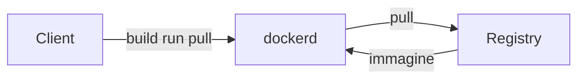

# Lezione 17 Containerization for Software Engineers

## Tendenze del settore software

Il settore del software è passato da un modello monolitico a servizi disaccoppiati distribuiti su molti ambienti.

- **Prima**: software **monolitico**, cicli di sviluppo lunghi, un solo ambiente di destinazione, scalata lenta.
- **Ora**: servizi **disaccoppiati**, miglioramenti rapidi e iterativi, molti ambienti di destinazione, scalata rapida necessaria.

## La complessità dei deployment

Ogni servizio indipendente combina molti stack e deve raggiungere molti ambienti di destinazione.

- **Molteplicità di stack**: ogni servizio usa linguaggi, framework e database propri (es. Python, Java, PostgreSQL, Redis).
- **Molteplicità di ambienti**: ambienti di sviluppo, pre-produzione, QA, staging e produzione (on-premises, cloud pubblico, soluzioni ibride), più il disaster recovery.

Due domande definiscono la sfida: i servizi interagiscono correttamente tra loro? È possibile migrare senza intoppi tra gli ambienti?

### La «Matrix from Hell»

> [!def] Matrix from Hell
> **Matrice** ottenuta incrociando gli N stack (Web App, API Endpoint, Analytics, App DB, Queue, Preprocessing) con gli M ambienti (dev laptop, production server, disaster recovery, public cloud, QA server): prima dei container ogni cella è un punto interrogativo, cioè una combinazione stack-ambiente da configurare e verificare separatamente.

## L'analogia del trasporto merci

Il problema del software ricalca quello del trasporto merci prima degli anni Sessanta.

- **Molteplicità delle merci**: beni diversi che possono interagire tra loro.
- **Molteplicità dei mezzi**: metodi di trasporto e stoccaggio diversi, con passaggi difficili dall'uno all'altro.

> [!def] Container da trasporto
> **Contenitore standardizzato** per le merci che risolve la molteplicità dei beni e dei mezzi di trasporto.

I container da trasporto hanno queste proprietà.

- **Standardizzati**: hanno tutti le stesse dimensioni.
- **Versatili**: possono essere caricati con praticamente qualsiasi merce.
- **Preparati dai responsabili della spedizione**, che garantiscono che dentro non avvengano interazioni indesiderate.
- **Sigillati** fino alla consegna finale.
- **Uniformi durante il trasporto**: durante il viaggio tutti i container sono uguali, facili da caricare, scaricare e impilare.

### Container per il codice

La stessa soluzione vale per il software: gli **stack** corrispondono alle merci, gli **ambienti hardware** ai mezzi di trasporto e stoccaggio.

## Container software

I container risolvono la «Matrix from Hell»: ogni combinazione stack-ambiente riceve lo stesso contenitore standardizzato. Separano inoltre le responsabilità tra chi sviluppa e chi gestisce l'esercizio.

- **Sviluppatori**: si curano solo di ciò che sta **dentro** il container; setup dell'ambiente di sviluppo semplificato; nessun conflitto di librerie e dipendenze; *build once, run anywhere*.
- **Operations**: si curano solo di ciò che sta **fuori** dal container; ogni container si gestisce allo stesso modo; gestione del ciclo di vita semplificata; *configure once, run anything*.

> [!warning] Limiti della portabilità
> La portabilità dei container vale entro la **stessa architettura e lo stesso kernel**: *build once, run anywhere* significa ovunque con architettura uguale e kernel Linux moderno; *configure once, run anything* significa qualsiasi software costruito sulla stessa architettura e kernel.

## Macchine virtuali vs container

Le macchine virtuali risolvono gli stessi problemi dei container, ma sono meno leggere.

- Ogni VM porta con sé un **Guest OS** completo per ogni applicazione; il container condivide il sistema operativo dell'host tramite il container engine.
- I container consentono deployment, riavvio ecc. **significativamente più rapidi**.

La differenza di struttura è riassunta nella tabella.

| Strato | Macchine virtuali | Container |
| --- | --- | --- |
| Per ogni app | App + Bins/Libs + Guest OS | App + Bins/Libs |
| Strato condiviso | Hypervisor | Container engine |
| Base | Infrastructure | Operating System + Infrastructure |

## Docker

### Docker come container engine

> [!aside]
> > [!def] Docker
> > **Container engine** de facto standard per la containerizzazione del software, progetto nato nel 2013.
> 
> ---
> 
> ![[Lezione 16-1793204520758.png|50]]

Docker è diffusissimo, ma non è l'unico.

- È usato da più di **13 milioni di sviluppatori**, con più di **9 milioni di applicazioni dockerizzate**.
- Esistono alternative: LXD, BuildKit, Buildah, Podman.

### Architettura di Docker

L'architettura separa il client, l'host Docker e il registry delle immagini.

- **Client**: tool a riga di comando o Docker Desktop GUI; invia al daemon comandi come `build`, `pull`, `run`.
- **Docker host**: ospita il **daemon** (`dockerd`), che costruisce le immagini ed esegue i container.
- **Registry**: archivio di immagini (DockerHub, JFrog, Quay.io) da cui il daemon scarica le immagini.

Il flusso di comandi e immagini è sintetizzato dal diagramma.



### Immagini Docker

> [!def] Immagine Docker
> **Template portatile e in sola lettura** che contiene tutte le istruzioni per creare un container.

> [!aside]
> Un'immagine si ottiene in tre modi.
> 
> - **Caricata** da un file archivio tar.
> - **Scaricata** da un registry.
> - **Costruita** estendendo un'immagine esistente con una lista di istruzioni scritte in un Dockerfile.
> 
> ---
> 
> ![[3fed1cdb228ca6c5727835e7be749a535b4d369d14b4f59412426ac563a39ef8.png|100]]

### Dockerfile

> [!def] Dockerfile
> **Insieme di comandi** per assemblare un'immagine, a partire da un'immagine base.

I comandi principali del Dockerfile sono i seguenti.

- **`FROM`**: immagine base di partenza.
- **`RUN`**: esegue comandi (es. installazione di pacchetti).
- **`COPY`**: copia file dalla directory del Dockerfile nel filesystem del container.
- **`EXPOSE`**: espone una porta del container verso il Docker host.
- **`ENV`**: imposta variabili d'ambiente.
- **`CMD`**: comando di default eseguito all'avvio del container.

Un Dockerfile minimo estende `ubuntu:20.04` installando pacchetti e copiando un file.

```dockerfile
FROM ubuntu:20.04
RUN apt update -qq && apt install -y -q fortune cowsay
COPY ./file.txt /home/file.txt
CMD bash
```

## Comandi Docker essenziali

La gestione di immagini e container avviene tramite la CLI `docker`.

### Immagini

Le immagini si ottengono, ispezionano e costruiscono con questi comandi.

- **`docker pull <immagine>`** scarica un'immagine dal registry (es. `docker pull ubuntu:20.04`).
- **`docker image list`** elenca le immagini locali con repository, tag, ID e dimensione.
- **`docker build -t <nome> .`** costruisce un'immagine dal Dockerfile della directory corrente; i layer già costruiti vengono riutilizzati dalla cache.

### Ciclo di vita di un container

Un container attraversa creazione, avvio, esecuzione e rimozione.

- **`docker run -it --name <nome> <immagine>`** crea e avvia un container con terminale interattivo.
- **`docker container list --all`** elenca tutti i container, inclusi quelli arrestati.
- **`docker start <container>`** riavvia un container arrestato.
- **`docker attach <container>`** collega il terminale alla sessione principale del container.
- **`docker exec -ti <container> <comando>`** esegue un comando in un container in esecuzione senza collegarsi alla sua sessione principale.
- **`docker kill <container>`** termina un container in esecuzione.
- **`docker rm <container>`** elimina un container arrestato.

### Detach e trasferimento file

Durante l'esecuzione ci si può scollegare dal terminale e scambiare file con l'host.

- Il **detach** dal terminale interattivo si esegue premendo `CTRL+P` seguito da `CTRL+Q`, senza arrestare il container.
- **`docker cp <sorgente> <destinazione>`** copia file tra host e container in entrambe le direzioni (es. `docker cp ./file.txt my-first-container:/home/file.txt`).

## Applicazioni container-native

> [!def] Software container-native
> **Software** per cui i container sono le unità di infrastruttura di primo livello (non server o VM), progettato per i container fin dall'inizio.

### Architettura dell'applicazione

L'applicazione di riferimento è una web app a microservizi con tre funzionalità: ottenere un messaggio fortune, ottenere la versione maiuscola di qualsiasi stringa, ottenere la versione maiuscola del proprio messaggio fortune.

- **Frontend**: pagina web con un po' di JavaScript.
- **Backend**: due microservizi che comunicano tramite **HTTP**, un protocollo web standard.
- **Fortune service**: Nodejs ed Express.
- **Uppercase service**: Python e Flask.

![[4cad402a5e752becc4b9cfb39de98a5c19ad52e48baba9442159ea43de52220a.png|200]]

### Fortune service

Il fortune service offre una sola funzione: restituisce un messaggio fortune scelto per l'utente corrente.

- L'utente invia una richiesta **GET** all'endpoint `/fortune`, cioè `http://{fortune-service-location}/fortune`.
- Il servizio risponde con un JSON contenente il campo `fortune`.

```js
app.get('/fortune', (req, res) => {
  const fortunes = ["Great fortune!", "Meh, average fortune",
                    "Terrible fortune! Be careful!"]
  var fortune = fortunes[Math.floor(Math.random()*fortunes.length)]
  res.send({ 'fortune': fortune })
})
```

### Uppercase service

L'uppercase service offre due funzioni: rendere maiuscola una stringa e restituire un fortune maiuscolo.

- **Maiuscole**: l'utente invia una **POST** all'endpoint `/uppercase` con body JSON contenente il campo `message`; il servizio risponde con un JSON con i campi `original` e `uppercase`.
- **Fortune maiuscolo**: l'utente invia una **GET** all'endpoint `/uppercase-fortune`; il servizio recupera un fortune dal fortune service, lo rende maiuscolo e lo restituisce nel campo `fortune`.

```python
@app.route('/uppercase', methods=['POST'])
def uppercase():
    data = request.json            # dati JSON nel body della richiesta
    message = data["message"]
    return jsonify({'original': message,
                    'uppercase': message.upper()})
```

Il secondo snippet mostra la **composizione tra servizi**: l'uppercase service invoca il fortune service via HTTP e combina il risultato.

```python
@app.route('/uppercase-fortune')
def uppercase_fortune():
    req = requests.get(f"{fortune_baseurl}/fortune")
    data = req.json()
    return jsonify({'fortune': data['fortune'].upper()})
```

### Vista completa dell'applicazione

Nella vista completa gli utenti raggiungono l'app dal browser: il frontend è servito da un web server **Nginx**, che espone la GUI verso gli utenti, mentre i due servizi stanno nel backend.

![[6caed5e16afe30c01d7b23f837cbbf69ed6a259947de410f61684dd916976692.png|309x147]]

### Diagramma di sequenza

Le interazioni tra utente, frontend e servizi seguono questo diagramma di sequenza.

![[5712c1311890522fe65bb1885261fce647ea11175ac77c45fb38dcd6975a6e23.png|383x193]]

### Immagini Docker dei servizi

Ogni componente dell'app viene containerizzato con un proprio Dockerfile.

Il fortune service parte dall'immagine base Nodejs 14; **`WORKDIR`** imposta la directory di lavoro base del container.

```dockerfile
FROM node:14
WORKDIR /home/app
COPY package*.json .
COPY app.js .
RUN npm install
EXPOSE 3000
CMD node app.js
```

L'uppercase service parte dall'immagine base Python 3.8; `--host 0.0.0.0` rende l'app raggiungibile dall'esterno del container.

```dockerfile
FROM python:3.8
COPY ./requirements.txt /home/requirements.txt
RUN pip3 install -r /home/requirements.txt
COPY app.py /home/app.py
EXPOSE 5000
CMD flask --app /home/app.py run --host 0.0.0.0
```

Il web server che ospita la GUI parte dall'immagine Nginx e copia la pagina nel document root predefinito.

```dockerfile
FROM nginx:latest
COPY ./website /usr/share/nginx/html
```

### Orchestrazione con docker-compose

> [!def] Docker Compose
> **Strumento di orchestrazione** che definisce e avvia applicazioni multi-container a partire da un unico file YAML.

Il file compose descrive i servizi dell'applicazione.

```yaml
version: "3.9"
services:
  frontend:
    build: ./frontend/
    container_name: "uppercase-fortune-frontend"
    depends_on:
      - fortune-service
      - uppercase-service
    ports:
      - "8080:80"
  fortune-service:
    build: ./fortune/
    container_name: "fortune-service-container"
    ports:
      - "3000:3000"
  uppercase-service:
    build: ./uppercase/
    container_name: "uppercase-service-container"
    environment:
      FORTUNE_URL: http://fortune-service:3000
    depends_on:
      - fortune-service
    ports:
      - "5000:5000"
```

Le direttive chiave del file sono le seguenti.

- **`build`**: directory contenente il Dockerfile del servizio.
- **`depends_on`**: impone l'ordine di avvio dei servizi (frontend dopo i due servizi di backend, uppercase service dopo fortune service).
- **`ports`**: mappa le porte `host:container` (es. `"8080:80"` espone la porta 80 del container sulla porta 8080 dell'host).
- **`environment`**: variabili d'ambiente del container; l'uppercase service raggiunge il fortune service tramite il nome del servizio nell'URL.
- **`container_name`**: nome assegnato al container.

L'avvio dell'intero progetto avviene con `docker-compose -p "uppercase-fortune-app" up -d`: compose costruisce le immagini, crea la rete di default del progetto e avvia i container di tutti i servizi.