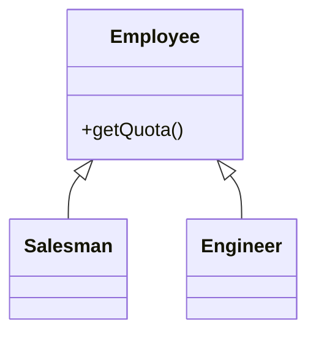
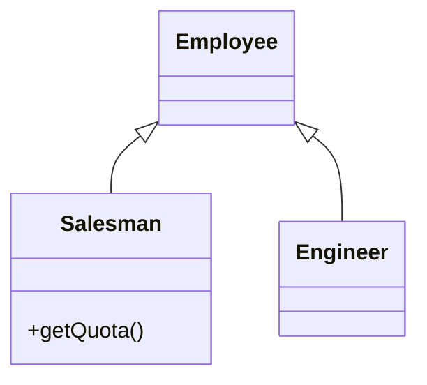
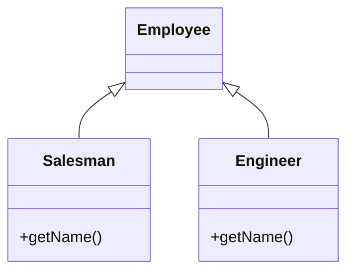
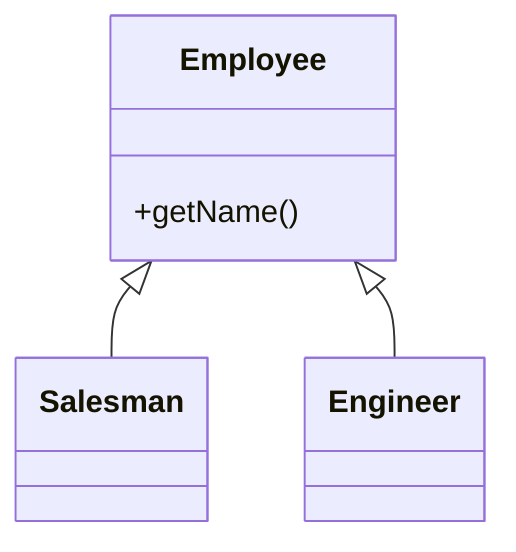

# Lezione 19 Refactoring

## Definizione e motivazioni

> [!quote] Martin Fowler
> "Any fool can write code that a computer can understand. Good programmers write code that humans can understand."

La comprensibilità del codice da parte degli umani è la motivazione alla base del refactoring, che Fowler definisce in due sensi.

> [!def] Refactoring
> **Modifica** apportata alla struttura interna del software per renderlo più facile da comprendere ed economico da modificare, senza cambiarne il comportamento osservabile.
> **Refactor** (verbo) significa ristrutturare il software applicando una serie di refactoring senza cambiarne il comportamento osservabile.

### Rinominare variabili, metodi e classi

Un esempio tipico di refactoring è la ridenominazione di variabili, metodi e classi per chiarezza, che migliora la comprensibilità del codice senza cambiarne il comportamento.

```java
int n = numberOfRentals();
int n2 = numberOfDaysSinceStart();      // Nope
double number = n / n2;

int numberOfRentals = numberOfRentals();
int numberOfDays = numberOfDaysSinceStart();   // Better
double averageRentalsPerDay = numberOfRentals / numberOfDays();
```

### Il catalogo di Fowler

> [!info] Il catalogo di Fowler
> Il catalogo è una raccolta di piccole trasformazioni applicabili al codice, ciascuna con motivazione, spiegazione, varianti ed esempi, come *Extract interface*, *Move method*, *Pull up constructor body*.
> Contiene **22 bad smells**, cioè cose a cui fare attenzione ("anti-pattern"), e **72 refactoring**, cioè cosa fare quando li si trovano.
> I refactoring spesso esistono in **coppie di duali**, come *Replace inheritance with delegation* e *Replace delegation with inheritance*.
> Come per il libro dei GoF sui design pattern, le voci del catalogo si sovrappongono e i confini concettuali sfumano.

## Code smells

> [!def] Code smell
> **Indicazione** che nel sistema esistono problemi di design.

Le tecniche di refactoring servono a correggere i code smells; la maggior parte è abbastanza semplice e oggi gode di buon supporto negli IDE. Nuovi smell e nuovi refactoring vengono "scoperti" di continuo, quindi l'elenco dei nomi è piuttosto lungo. Il ciclo di lavoro tipico parte da codice sporco contenente bad smells e arriva a codice pulito applicando il refactoring, che migliora il codice senza cambiarne il comportamento.

## Tipologie di bad smells

I bad smells si raggruppano in cinque categorie secondo la loro natura.

### Bloaters

I **bloaters** sono porzioni di codice, metodi e classi cresciute fino a proporzioni gigantesche, tali da essere difficili da gestire; di solito non compaiono subito ma si accumulano durante l'evoluzione del programma, soprattutto se nessuno si sforza di eradicarli. Esempi: *Long Method*, *Large Class*, *Primitive Obsession*, *Long Parameter List*, *Data Clumps*.

### Object-Orientation Abusers

Gli **object-orientation abusers** sono tutti smell derivanti dall'applicazione incompleta o errata dei principi della programmazione orientata agli oggetti. Esempi: *Alternative Classes with Different Interfaces*, *Refused Bequest*, *Switch Statements*, *Temporary Field*.

### Change Preventers

I **change preventers** sono smell per cui cambiare qualcosa in un punto del codice richiede molte modifiche anche in altri punti, rendendo lo sviluppo molto più complicato e costoso. Esempi: *Divergent Change*, *Parallel Inheritance Hierarchies*, *Shotgun Surgery*.

### Dispensables

Un **dispensable** è qualcosa di inutile e superfluo la cui assenza renderebbe il codice più pulito, più efficiente e più facile da capire. Esempi: *Comments*, *Duplicate Code*, *Data Class*, *Dead Code*, *Lazy Class*, *Speculative Generality*.

### Couplers

I **couplers** sono smell che contribuiscono a un accoppiamento eccessivo tra classi o che mostrano cosa accade quando l'accoppiamento è sostituito da una delega eccessiva. Esempi: *Feature Envy*, *Incomplete Library Class*, *Message Chains*, *Middle Man*.

## Debito tecnico

### Definizione

> [!def] Debito tecnico
> **Condizione** in cui il codice soddisfa i requisiti funzionali ma è subottimale o realizzato in fretta ("quick and dirty").

Il debito tecnico si manifesta ad esempio come codice "sporcato" dai bad smells, algoritmi inefficienti o design trascurato. Può essere corretto in code review oppure generare TODO o nuove issue nel issue tracker; capirlo, misurarlo e comunicarlo è critico nell'industria del software.

### Analogia del debito

Il debito non è sempre negativo, perché nella vita reale conta consegnare codice funzionante.

> [!quote] Ward Cunningham
> "Shipping first time code is like going into debt. A little debt speeds development so long as it is paid back promptly with a rewrite – the danger occurs when the debt is not repaid. Every minute spent on not-quite-right code counts as interest on that debt."

Le domande decisive da porsi sono tre:

- Ci si può permettere di lavorare senza debito?
- Ci si può permettere di pagarne gli interessi?
- Si riesce a tenere debito e interessi gestibili?

### Debito strategico e intenzionale

La definizione originale di Cunningham considerava solo il debito intenzionale: il debito può essere "pianificato" oppure "capitato", e in entrambi i casi può essere strategico, secondo l'idea di consegnare subito e gestire le conseguenze dopo. Esempi di debito intenzionale o strategico: design non modulare, implementazione volutamente troppo semplice o troppo complessa, indifferenza alle prestazioni, mancanza di generalità o estensibilità, mancanza di scalabilità.

### Debito non strategico e non intenzionale

Il debito si accumula anche involontariamente, perché nessun processo di sviluppo è perfetto. Esempi di debito non intenzionale o non strategico: bad smells, memory leak, copertura di test insufficiente, implementazione involontariamente complessa, architettura rigida o fragile, colli di bottiglia nelle prestazioni o nella scalabilità, codice trascurato o difficile da mantenere.

### Conseguenze del debito

Un debito tecnico eccessivo produce effetti a cascata sullo sviluppo.

- Un debito eccessivo significa troppo tempo speso a pagare gli interessi.
- Rende imprevedibile la fase di pianificazione del software e aumenta il rischio di investimento.
- Rallenta il lavoro futuro.
- Genera più bug, più costosi da correggere.
- Produce sviluppatori frustrati e infelici.

### Misurazione

Strumenti di qualità come **SonarQube** possono fornire una stima accurata del debito tecnico accumulato in un repository software.

## Il processo di refactoring

### Metafora di base

Il refactoring parte da una base di codice esistente e la migliora: cambia la struttura interna (in-the-small fino a in-the-medium) preservando la semantica complessiva, cioè riarrangia i "fattori" mantenendo invariato il "prodotto" finale. L'idea è migliorare il codice in qualche modo significativo, ad esempio:

- Ridurre il codice quasi duplicato.
- Migliorare coesione e accoppiamento.
- Migliorare parametrizzazione, comprensibilità, manutenibilità, flessibilità, astrazione, efficienza.

### Il ciclo di refactoring

Il pattern base per refactorare un programma funzionante prevede tre passi:

1. Scegliere il bad smell peggiore.
2. Selezionare un refactoring che lo affronti.
3. Applicare il refactoring.

A ogni giro del ciclo si selezionano refactoring che migliorano il codice; il comportamento del programma non cambia, quindi il programma resta in uno stato funzionante: il ciclo migliora il codice mantenendo il comportamento. La parte più insidiosa del processo è identificare lo smell: all'inizio conviene partire dalle cose facili, come spezzare routine lunghe o rinominare per chiarezza, così i problemi restanti si vedono e si correggono più facilmente.

### Refactoring e unit test

Il refactoring dipende fortemente da una buona suite di **unit test**: si refactora, poi si eseguono i test automatici per verificare che il comportamento sia davvero preservato. Senza buoni unit test gli sviluppatori tendono a evitare il refactoring, per paura di rompere qualcosa.

### Perché refactorare

Nella realtà è estremamente difficile ottenere il design "giusto" la prima volta, per vari motivi:

- È difficile capire a fondo il dominio del problema.
- È difficile capire i requisiti degli utenti, anche quando sono chiari per l'utente stesso.
- È difficile prevedere come il sistema evolverà tra X anni.
- Il design originale spesso si rivela inadeguato.
- Il sistema col tempo diventa fragile e più difficile da cambiare.

Il refactoring aiuta a manipolare il codice in un ambiente sicuro che preserva il comportamento, a ricreare una situazione in cui l'evoluzione è possibile e a comprendere il codice esistente. I suoi benefici principali sono:

- **Migliora il design** del software: senza refactoring il design decade, e il codice mal progettato richiede più righe per fare le stesse cose, spesso perché fa la stessa cosa in punti diversi.
- **Rende il software più facile da capire**, perché prima o poi qualcun altro dovrà leggere il codice.
- **Aiuta a trovare i bug**.
- **Aiuta a programmare più in fretta**.

## Refactoring tipici

I refactoring tipici si dividono in tre categorie secondo l'elemento coinvolto.

| Class Refactorings | Method Refactorings | Attribute Refactorings |
|---|---|---|
| add (sub)class to hierarchy | add method to class | add variable to class |
| rename class | rename method | rename variable |
| remove class | remove method | remove variable |
| Extract class | push method down | push variable down |
| | push method up | pull variable up |
| | add parameter to method | create accessors |
| | move method | abstract variable |
| | extract code in new method | |
| | replace parameter with method | |

### Extract Method

*Extract Method* estrae un frammento di codice in un nuovo metodo, invocato al posto del codice estratto: le stampe dei dettagli, prima inline in `printOwing`, diventano il metodo `printDetails`.

```java
void printOwing() {
    printBanner();
    printDetails(getOutstanding());
}

void printDetails(double outstanding) {
    System.out.println("amount " + outstanding);
}
```

### Push method down

Si applica quando il comportamento di una superclasse è rilevante solo per alcune delle sue sottoclassi: il metodo va spostato in quelle sottoclassi. Nel diagramma `getQuota()` è inizialmente definito in `Employee` anche se interessa solo `Salesman`:



Dopo il refactoring il metodo vive solo nella sottoclasse che lo usa:



### Push method up

Si applica quando più sottoclassi hanno metodi con risultati identici: i metodi vanno spostati nella superclasse. Inizialmente `getName()` è duplicato in entrambe le sottoclassi:



Dopo il refactoring il metodo è definito una sola volta nella superclasse:



### Add parameter to method

Si applica quando un metodo necessita di più informazioni dal chiamante: si aggiunge un parametro per un oggetto che può passare queste informazioni, ad esempio `getContact()` diventa `getContact(Date)`.

### Replace Parameter with Method

Si applica quando un oggetto invoca un metodo e ne passa il risultato come parametro a un altro metodo, mentre anche il ricevente potrebbe invocare il metodo direttamente: il parametro `discountLevel` sparisce perché il ricevente può calcolarselo da sé.

```java
int basePrice = _quantity * _itemPrice;
double finalPrice = discountedPrice(basePrice);
```

## Bad smells e rimedi

Per ciascun bad smell del catalogo esistono refactoring raccomandati che lo eliminano.

### Duplicated Code

Se la stessa struttura di codice compare in più punti, il programma migliorerà trovando un modo di unificarla. I casi principali sono tre:

- La stessa espressione in due metodi della stessa classe si risolve applicando *Extract Method* e invocando il codice da entrambi i punti.
- La stessa espressione in due sottoclassi fratelle si risolve con *Extract Method* in entrambe le classi e poi *Pull Up Field*.
- Il codice duplicato in due classi non correlate si affronta con *Extract Class* in una classe e usando il nuovo componente nell'altra.

### Long Method

Quanto più una procedura è lunga, tanto più è difficile da capire; i programmi a oggetti vivono al meglio e più a lungo con metodi corti. Quasi sempre basta *Extract Method* per accorciare un metodo; se l'estrazione richiede molti parametri, si può creare una nuova classe che li incapsuli.

### Large Class

Quando una classe cerca di fare troppo, lo mostra con troppe variabili d'istanza, e dove ci sono troppe variabili d'istanza il codice duplicato non è lontano; anche una classe con troppo codice è un terreno fertile per la duplicazione. In entrambi i casi funzionano *Extract Class* ed *Extract Subclass*.

### Long Parameter List

Alla vecchia scuola si passava tutto come parametro, cosa comunque migliore dei dati globali; con gli oggetti non serve passare tutto ciò di cui il metodo ha bisogno, ma abbastanza perché possa arrivare a tutto. Le liste di parametri lunghe sono difficili da capire, incoerenti, difficili da usare e in continua evoluzione man mano che servono nuovi dati. Si risolve così:

- *Replace Parameter with Method*, quando il dato può essere ottenuto con una richiesta a un oggetto già noto.
- *Introduce Parameter Object*, quando un gruppo di parametri va naturalmente insieme e si trasforma in un oggetto.

```java
public void marry(String name, int age, boolean gender,
    String name2, int age2, boolean gender2) {...}
// diventa
public void marry(Person person1, Person person2) {...}
```

### Divergent Change

La **divergent change** si verifica quando una classe è comunemente modificata in modi diversi per ragioni diverse: quasi certamente si violano i principi di astrazione chiave e di separazione delle responsabilità. Si sistema identificando tutto ciò che cambia per una particolare causa e applicando *Extract Class* per raccoglierlo in un unico posto.

### Shotgun Surgery

La **shotgun surgery** si verifica quando ogni modifica di un certo tipo richiede molte piccole modifiche in molte classi diverse: la stessa frequenza di cambiamento in oggetti diversi, in particolare scollegati, è tipicamente il risultato della copy-paste programming. Con i cambiamenti sparsi è facile dimenticarne uno importante. Si risolve con *Move Method* e *Move Field* per concentrare tutte le modifiche in una sola classe; se nessuna classe esistente è un buon candidato, la si crea.

### Feature Envy

> [!def] Feature envy
> **Smell** in cui un metodo sembra più interessato a una classe diversa da quella in cui si trova, tipicamente per i suoi dati: fa un uso massiccio di dati e metodi dell'altra classe.

Si risolve con *Move Method* per spostare il metodo nella classe che lo interessa; se solo una parte del metodo fa un uso massiccio delle caratteristiche dell'altra classe, si applica *Extract Method* per estrarre le parti che vi appartengono.

### Data Clumps

I **data clumps** sono gli stessi tre o quattro dati che compaiono insieme in molti posti, come campi in un paio di classi o parametri in molte firme di metodi: gruppi di dati che stanno davvero insieme dovrebbero diventare un oggetto a sé, come `x`, `y` che diventano `Point`. Per i campi si usa *Extract Class* per trasformare il gruppo in un oggetto; per i parametri si usano *Introduce Parameter Object* o *Preserve Whole Object* per snellirli.

### Primitive Obsession

La **primitive obsession** è la riluttanza a introdurre piccole classi per cose facilmente rappresentate con primitivi: numeri di telefono, codici di avviamento, somme di denaro, intervalli con limiti superiore e inferiore. Se la primitiva necessita di dati o comportamenti aggiuntivi, ad esempio una formattazione speciale come `(215)898-0587` o `19104-6389`, va trasformata in una classe.

### Switch Statements

Nella maggior parte dei casi in cui si vede uno `switch` sul tipo si dovrebbe considerare il polimorfismo:

> L'essenza del polimorfismo è che invece di chiedere a un oggetto di che tipo è e poi invocare un comportamento in base alla risposta, si invoca direttamente il comportamento: l'oggetto, a seconda del suo tipo, fa la cosa giusta.

Si applica *Extract Method* per estrarre lo `switch` e poi *Move Method* per portarlo nella classe dove serve il polimorfismo.

### Parallel Inheritance Hierarchies

Le **parallel inheritance hierarchies** sono in realtà un caso particolare di shotgun surgery: ogni volta che si crea una sottoclasse di una classe, occorre creare una sottoclasse di un'altra. Secondo Cunningham si può rimuovere il parallelo refactorando una o entrambe le gerarchie fino a rendere i membri congruenti e poi collassandole a coppie, oppure si può rimuovere la duplicazione tra i paralleli definendo responsabilità distinte raffinate da ciascuna gerarchia e ricollocando i metodi di conseguenza. Con *Move Method* e *Move Field* la gerarchia della classe che si riferisce all'altra scompare.

### Lazy Class

Ogni classe creata costa tempo e denaro da mantenere e capire: una classe che non si guadagna il suo mantenimento va eliminata. Per sottoclassi che fanno troppo poco si usa *Collapse Hierarchy*; per componenti quasi inutili si usa *Inline Class*.

### Speculative Generality

La **speculative generality** si presenta quando qualcuno dice "penso che un giorno ci servirà la capacità di fare questo" e servono hook e casi speciali per gestire cose non richieste; si rileva facilmente quando gli unici utilizzatori di una classe o metodo sono i test case. Si combatte così:

- *Collapse Hierarchy* per le classi astratte che non fanno abbastanza.
- *Inline Class* per la delega non necessaria.
- *Remove Parameter* per i metodi con parametri inutilizzati.
- *Rename Method* per i metodi con nomi astratti e incomprensibili.

### Temporary Field

Il **temporary field** è un oggetto in cui una variabile d'istanza è impostata solo in certe circostanze: il codice diventa difficile da capire, perché di solito ci si aspetta che un oggetto usi tutte le sue variabili. Si risolve con *Extract Class*, che crea una casa per queste variabili orfane spostandovi tutto il codice che le usa.

### Message Chains

Le **message chains** si verificano quando un client chiede a un oggetto un altro oggetto, che a sua volta chiede un altro oggetto e così via, come in `intermediate.getProvider().doSomething()`: navigando in questo modo il client assume la struttura della gerarchia.

```cpp
color = vehicle->getChassis()->getBody()->getShell()
    ->getMaterial()->getProperties()->getColor();
```

### Middle Man

Una delle caratteristiche principali degli oggetti è l'incapsulazione, che spesso comporta la delega; a volte però la delega va troppo in là, come quando metà dei metodi di una classe sono semplici deleghe a un'altra classe. I rimedi possibili sono tre:

- *Remove Middle Man*, per parlare direttamente all'oggetto che sa davvero cosa sta succedendo: il client, che prima invocava `Person.getManager()` come semplice delega a `Department`, ottiene il `Department` da `Person` e invoca direttamente `getManager()`.
- *Inline Method*, se solo pochi metodi fanno poco, per inlinearli nel chiamante.
- *Replace Delegation with Inheritance*, se c'è un comportamento aggiuntivo, per trasformare il middle man in una sottoclasse dell'oggetto reale.

## Osservazioni finali

### Refactoring vs restructuring

> [!info] Refactoring vs restructuring
> Il termine "refactoring" è spesso usato a sproposito: se un sistema resta rotto per un paio di giorni mentre si "refattorizza", o se si parla di refactoring di un documento, si sta facendo restructuring.
> **Lo restructuring** è qualsiasi riarrangiamento di parti di un tutto: un termine molto generale che non implica alcun modo particolare di procedere.
> **Il refactoring** è invece una tecnica molto specifica, fondata su piccole trasformazioni che preservano il comportamento (esse stesse chiamate refactoring).
> Facendo refactoring, il sistema non dovrebbe restare rotto per più di pochi minuti alla volta, e non si vede come applicarlo a qualcosa che non ha un comportamento ben definito.