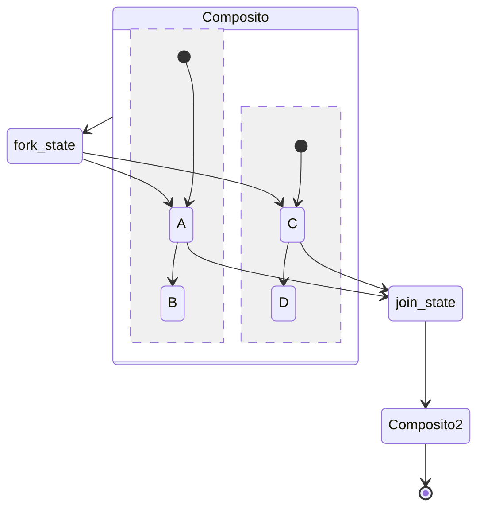

# Lezione 8 UML Statecharts

## UML Statecharts

> [!def] UML Statechart
> **Diagramma comportamentale** (noto anche come UML *Behavioural State Machine*), estensione degli *Statecharts* di Harel, usato per modellare gli aspetti dinamici di un sistema.

- **Sistemi reattivi**: sistemi che reagiscono a eventi esterni o interni; esempi tipici sono il software con GUI, gli oggetti nella programmazione orientata agli oggetti e i controllori embedded (es. ABS di un'automobile).
- **Usage industriale**: gli Statecharts sono usati anche oltre la modellazione; il software *embedded* viene spesso generato automaticamente da Statecharts, e la logica delle interfacce utente moderne può essere gestita tramite Statecharts.

## Stati e transizioni

- **Stato**: rappresenta una situazione in cui vale una condizione invariante; può essere **statico** (il sistema attende che qualcosa accada) o **dinamico** (il sistema sta eseguendo un compito specifico).
- **Transizione**: rappresenta un possibile cambiamento di stato.

## Sintassi

### Regioni, vertici e transizioni

- **Statechart UML**: contiene una **regione top-level**; una **regione** contiene **vertici** e **transizioni**.
- **Vertice**: rappresenta uno stato; ne esistono diversi tipi con semantiche diverse.
- **Transizione**: disegnata come arco diretto (*edge*) tra due vertici.

### Stati semplici

- **Stato semplice**: rappresenta stati di sistema non strutturati; è disegnato come rettangolo con angoli arrotondati.
- **Name compartment**: contiene il nome (opzionale) dello stato, come stringa.

### Pseudostati iniziali e stati finali

- **Pseudostato iniziale**: marca lo stato di default (iniziale); una regione può contenerne al massimo uno.
- **Stato finale**: modella una situazione in cui il calcolo è completato, cioè il sistema non processerà altri eventi.

### Sintassi delle transizioni

> [!aside]
> - **Etichetta di transizione**: ha la forma `triggers [guard] / actions`, dove ogni parte è opzionale.
> - **Trigger**: lista di eventi che possono indurre un cambiamento di stato.
> - **Guard**: condizione booleana.
> - **Actions**: lista di operazioni da eseguire quando la transizione scatta (*fires*).
> - **Self-transition**: una transizione può puntare allo stesso stato di partenza.
> 
> ---
> 
> ```mermaid
> stateDiagram-v2
>     [*] --> StatoA
>     StatoA --> StatoB : evento [condizione] / azione()
>     StatoA --> StatoA : evento
>     StatoB --> [*]
> ```
> 

## Semantica

Una transizione è **fireable** quando:

- sono stati generati eventi che corrispondono a **tutti** i trigger;
- la condizione nella **guard** valuta `TRUE`.

- **Transizione spontanea**: transizione senza trigger né guard.
- **Esecuzione delle azioni**: dopo lo scatto di una transizione viene eseguita la lista di azioni associata.
- **Non-determinismo**: se più transizioni sono fireable, ne scatta una sola, determinata non-deterministicamente.

```java
public class Counter {
    private int count = 0;
    private String mode = "increment";
    public void flick() {
        if (mode.equals("increment")) count++;
        else count--;
        if (count == 10) mode = "decrement";
        else if (count == 0) mode = "increment";
    }
}
```

Il contatore illustra come gli stati (la **mode**) e le transizioni siano codificati in un oggetto: variabili di istanza per lo stato, ramo condizionale per la transizione.

## Attività interne degli stati

Uno stato può contenere, opzionalmente, una lista di **attività interne**, ciascuna caratterizzata da un'etichetta che indica quando invocarla.

- **`entry` /**: attività eseguita all'ingresso nello stato.
- **`do` /**: attività eseguita per tutto il tempo in cui il sistema resta nello stato (dopo il completamento delle attività `entry`).
- **`exit` /**: attività eseguita all'uscita dallo stato.

## Stati compositi

- **Stato composito**: uno stato che contiene una **regione interna**; può avere name compartment, attività interne e una o più regioni interne.
- **Substate**: gli stati di una regione interna di un composito.
- **Gerarchia**: gli stati compositi permettono di definire una struttura gerarchica; la regione interna dettaglia il comportamento dello stato a cui appartiene.
- **Nascondere la complessità**: offrono un modo elegante e conciso di modellare comportamenti complessi e di nasconderla quando non necessaria.

### Regioni parallele

- **Regioni parallele**: un composito può contenere più regioni, che rappresentano comportamenti che possono avvenire in parallelo.
- **Uscita dal composito**: all'uscita da uno stato composito tutte le sue regioni vengono terminate.

### Pseudostati di history

- **Shallow history (`H`)**: rappresenta lo stato più recente attivo in un composito, ma **non** i substate di quel substate; presente solo negli stati compositi, al massimo uno per regione.
- **Deep history (`H*`)**: come lo shallow history, ma ripristina l'intera configurazione della regione, substate dei substate inclusi.

### Pseudostati di fork e join

- **Fork**: divide una transizione in ingresso in più transizioni che entrano in vertici di regioni ortogonali.
- **Join**: fonde transizioni uscenti da vertici di regioni ortogonali in un'unica transizione.
- **Equivalenza**: fork e join sono semanticamente equivalenti alle transizioni che entrano/escono singolarmente dai vertici delle regioni parallele.



## Consigli di modellazione

- **Transizioni di ingresso/uscita**: ogni stato dovrebbe avere tipicamente almeno una transizione in ingresso e una in uscita.
- **Senso di lettura**: i diagrammi si leggono tipicamente dall'alto a sinistra verso il basso a destra; posizionare pseudostati iniziali/finali di conseguenza.
- **Stati comuni**: se più stati condividono una condizione di ingresso e/o uscita, considerare l'uso di stati compositi.
- **Non-determinismo**: assicurarsi di non modellarlo, a meno che non sia davvero voluto.
- **Stato attivo**: al più uno stato può essere attivo in una regione in un dato istante.

## Model-driven Development

> [!info] Model-driven Development
> Passo successivo nella tendenza all'astrazione crescente; standard de facto in molti domini di software *embedded* (es. automotive). Con strumenti come **Simulink** è possibile simulare modelli Statechart, generare automaticamente codice e test, e applicare metodi formali.

Vantaggi e limiti del Model-driven Development:

- **Convenienza**: in alcuni domini è tipicamente più economico, più rapido e porta a qualità più alta.
- **Comprensibilità**: i modelli sono comprensibili dagli esperti di dominio.
- **Documentazione**: i modelli sono essi stessi documentazione.
- **Indipendenza**: minore dipendenza dalla tecnologia e dal personale.

> [!warning] Limiti del MDD
> - **Costo degli strumenti**: i tool sono costosi.
> - **Flessibilità**: non abbastanza flessibile per alcune applicazioni.
> - **Code generation**: tipicamente supportata per un numero limitato di piattaforme.

## Statecharts per la gestione delle UI

- **Guida alla logica di GUI**: gli Statecharts possono «guidare» la logica dell'interfaccia, essendo più facili da capire del codice.
- **Disaccoppiamento**: il comportamento è disaccoppiato dai componenti della GUI.
- **WHEN vs WHAT**: separare il *quando* (codificato nello Statechart) dal *cosa* deve accadere (codificato nel componente UI).
- **Scalabilità**: gli Statecharts scalano bene al crescere della complessità; studi hanno mostrato un numero di difetti inferiore per controllori di GUI basati su statechart.
- **XState**: libreria open-source JavaScript per creare, interpretare ed eseguire modelli statechart; si integra con librerie UI come React, Vue e Svelte, gestisce lo stato dell'interfaccia tramite Statecharts e supporta il testing. Disponibile su `https://xstate.js.org/`.