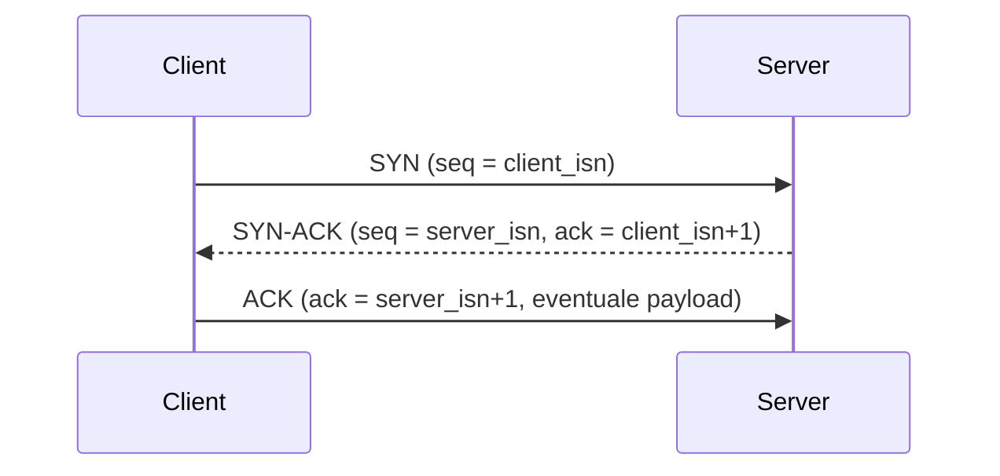
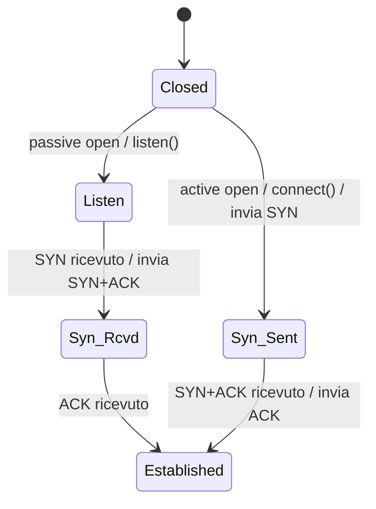
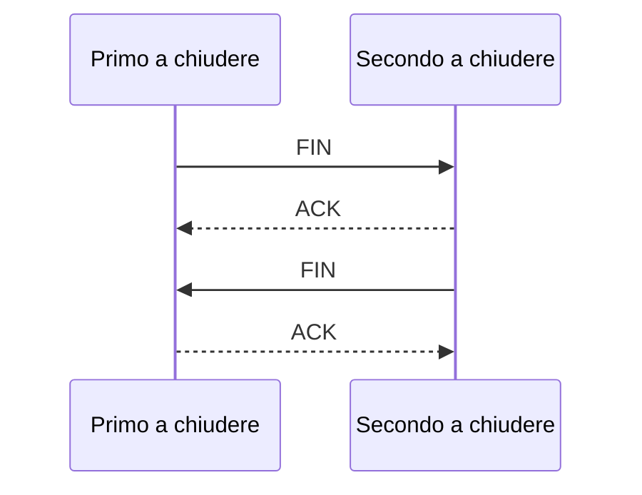
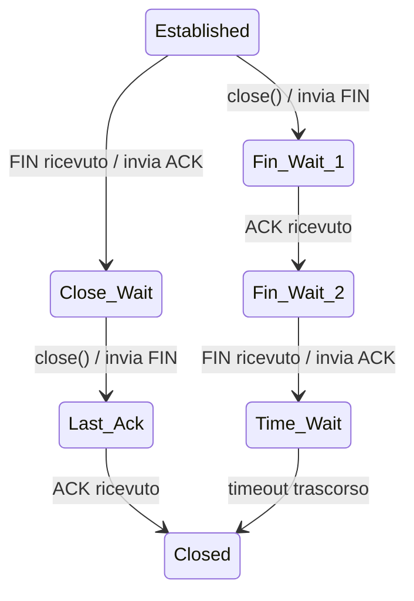

# Lezione 13 Transport Layer TCP gestione della connessione

## Il problema dell'accordo

TCP è orientato alla connessione: i due host devono **accordarsi** sia in apertura sia in chiusura. Sapendo che i messaggi possono perdersi o danneggiarsi, trovare l'accordo è difficile: se i messaggi si perdono, un capo può essere aperto (o chiuso) mentre l'altro no.

Per mitigare il problema TCP usa il **three-way handshake**: le richieste di apertura/chiusura devono essere confermate prima che la connessione sia stabilita/rilasciata.

> [!info] Il problema dei due eserciti
> **Dimostrazione classica** dell'impossibilità dell'accordo perfetto su un canale inaffidabile: due eserciti che devono attaccare simultaneamente non possono mai essere certi dell'accordo, perché chi invia l'ultima conferma non sa se è arrivata. Ogni handshake aggiuntivo (three-way, four-way) sposta solo l'incertezza sull'ultimo messaggio: **non esiste un protocollo perfetto**, ma il three-way handshake è di solito adeguato.

## Stabilimento della connessione

Il three-way handshake di TCP si articola in tre scambi:

1. Il client invia un segmento **SYN** al server.
2. Il server risponde con uno speciale acknowledgment, il segmento **SYN-ACK**.
3. Il client rimanda un acknowledgment finale, il segmento **ACK**.

Dettagli dei segmenti:

1. **SYN del client**: nessun payload, bit `SYN = 1`, e un numero di sequenza iniziale **casuale** (`client_isn`).
2. **SYN-ACK del server**: all'arrivo del SYN il server alloca **buffer e variabili TCP** e risponde con bit `SYN = 1` e `ACK = 1`, acknowledgment number `client_isn + 1` e un proprio numero di sequenza iniziale casuale (`server_isn`).
3. **ACK del client**: all'arrivo del SYN-ACK anche il client alloca **buffer e variabili** e invia l'ACK finale con bit `SYN = 0` (connessione stabilita), `ACK = 1`, acknowledgment number `server_isn + 1` e **possibilmente payload** applicativo.

Osservazioni:

- Lo stabilimento è una procedura **delicata** che può aggiungere ritardi significativi.
- Esiste un **timeout** (30–60 s) per completare il handshake, dopo il quale la procedura è abortita.
- In questa fase avvengono certi attacchi (es. **SYN flood**).

Diagramma degli stati (semplificato) dello stabilimento:

- Il server effettua la **passive open** (ascolta); il client effettua la **active open** (si connette).

## Rilascio della connessione

Il rilascio (*teardown*) può essere avviato da **uno qualsiasi** dei due host. Con client che chiude, l'handshake è:

1. Il client invia un segmento di **shutdown** (**FIN**) con bit `FIN = 1`.
2. Il server risponde con un segmento **ACK-FIN** (i bit `ACK` e `FIN` a 1): i due bit possono stare nello stesso segmento o in due segmenti separati.
3. Il client conferma lo shutdown del server con un **ACK** finale.

Diagramma degli stati (semplificato) del rilascio:

- Il **primo a chiudere** passa per `FIN-wait-1`, `FIN-wait-2` e `TIME_WAIT`; il **secondo a chiudere** per `CLOSE-WAIT` e `LAST-ACK`.
- Chi chiuso per primo resta in `TIME_WAIT` finché un **timer** non scade, prima di andare in `CLOSED`.

## Timer e perdite

Il three-way handshake non è perfetto: poiché i messaggi possono perdersi, TCP si affida a **timer** per chiudere definitivamente le connessioni o per **reinviare** le richieste; lo stesso meccanismo copre i casi di perdita durante il rilascio della connessione.