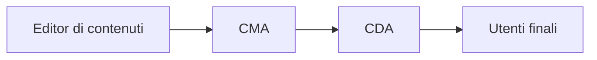
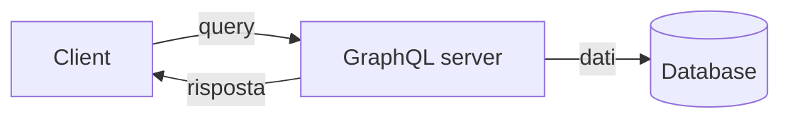
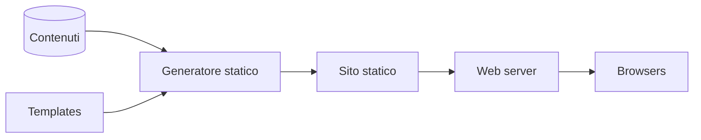

# Lezione 21 CMS (headless) e GraphQL

## La gestione dei contenuti

### Sfide

L'obiettivo chiave di molte web app è mostrare contenuti agli utenti. I contenuti possono cambiare molto frequentemente e crescere esponenzialmente (es. ~7M pagine su Wikipedia). Questo pone delle sfide:

- Codificare a mano intere pagine web per aggiornare i contenuti richiede competenze tecniche e rallenta il flusso di lavoro.
- Chi si occupa dei contenuti in genere non è uno sviluppatore web.
- Gestire versioni diverse dei contenuti pubblicati non è banale.
- Garantire l'adozione di un flusso di lavoro strutturato è difficile.

> [!def] CMS
> Un **Content Management System (CMS)** è una web application progettata per permettere la modifica collaborativa, l'organizzazione e la pubblicazione di contenuti, senza scrivere una sola riga di codice, tramite l'interfaccia utente (UI) fornita dal CMS stesso. Permette agli utenti non tecnici di gestire e aggiornare i contenuti senza dipendere costantemente dagli sviluppatori web. È spesso usato per blog, siti di news e siti e-commerce.

### Funzionalità

La maggior parte dei CMS include:

- **Web publishing**: i contenuti sono disponibili agli utenti tramite pagine web.
- **Formattazione dei contenuti**: tipicamente con un editor grafico WYSIWYG.
- **Version control**: tracciamento delle versioni multiple dello stesso contenuto.
- **Indicizzazione, ricerca e retrieval** dei contenuti.
- **Autenticazione/autorizzazione** degli utenti con un sistema di permessi basato su gruppi.
- **Media manager** integrato per i contenuti multimediali.
- **Estensibilità e personalizzabilità** tramite temi e plugin.

## Architetture CMS

### CMS tradizionali

I CMS tradizionali sono composti da due parti chiave:

- **Content Management Application (CMA)**: permette agli utenti non tecnici di gestire i contenuti (es. tramite le sue pagine web).
- **Content Delivery Application (CDA)**: rende i contenuti aggiornati disponibili agli utenti finali (es. come pagine web).



I CMS tradizionali hanno un'**architettura monolitica**: CMA e CDA sono strettamente integrate in un monolite. Questo rende i CMS tradizionali facili da distribuire e gestire (sono una singola web application con due componenti), ma comporta alcuni limiti:

- Potrebbero non essere abbastanza flessibili per certe esigenze.
- Potrebbero limitare i canali di distribuzione: i CMS tradizionali danno priorità agli output web; cosa fare se serve esporre una REST API?

> [!def] Headless CMS
> Un **headless CMS** è un CMS senza la sua «testa»: separa la CMA (il corpo, che si occupa dell'organizzazione dei contenuti) dalla CDA (la testa, che si occupa della presentazione). Non gestisce la presentazione dei contenuti ed espone solo un'API: così i contenuti possono essere distribuiti su qualsiasi canale serva.

> [!def] Decoupled CMS
> Un **decoupled CMS** è un CMS tradizionale in cui CMA e CDA sono disaccoppiate: si può usare la CDA inclusa oppure implementare modi diversi di distribuire i contenuti usando le API esposte dalla CMA. La maggior parte dei CMS tradizionali è oggi decoupled (es. WordPress).

### Sicurezza dei CMS

I CMS sono ottimi bersagli per gli attacchi: lo stesso CMS è usato su un gran numero di siti web, quindi una vulnerabilità in un CMS può essere sfruttata su un grande numero di siti. È imperativo tenere i CMS aggiornati per applicare le patch alle vulnerabilità appena possibile (es. vulnerabilità di SQL injection in WordPress 3.7.3–5.8.3 e in Joomla! 3.0.0–3.10.6 e 4.0.0–4.1.0).

### CMS tradizionali diffusi

Esistono numerosi CMS; i più noti:

- **WordPress**: il CMS più popolare, usato da ~43% di tutti i siti web.
- **Joomla**.
- **WooCommerce**: soluzione per siti e-commerce.
- **MediaWiki**: alimenta Wikipedia, Fandom, WikiHow…

Un CMS tradizionale si installa tipicamente come una web app qualunque: in fase di installazione si specificano i dati di connessione a un database relazionale (url, username, password), il CMS crea le tabelle necessarie e si definiscono le credenziali dell'account di amministrazione. Dopo l'installazione, l'admin può creare e organizzare i contenuti, aggiungere utenti, definire i template e personalizzare l'aspetto del sito.

## CMS headless: Strapi

CMS headless diffusi:

- **Strapi** (basato su Node.js).
- **Wagtail** (basato sul framework Django per Python).
- **Ghost** (basato su Node.js).
- **CrafterCMS** (basato su Java).

### Creazione del progetto

```bash
npx create-strapi-app@latest project-name
cd project-name
npm run develop
```

`npx create-strapi-app` è il modo più rapido per iniziare: un wizard chiede informazioni di base sul progetto, crea il progetto npm e installa le dipendenze. `npm run develop` avvia Strapi in modalità development, con il pannello di amministrazione su `/admin` e il server sulla root.

### Definizione delle risorse

Tramite la GUI si definisce la «shape» delle risorse da gestire (content type con campi, es. campi di tipo string o number), si definiscono le **relazioni tra risorse** usando l'editor visuale e si creano i contenuti effettivi, sempre tramite la GUI.

### REST API generata automaticamente

Per ogni risorsa, Strapi genera automaticamente gli endpoint REST:

| Metodo | URL | Descrizione |
|---|---|---|
| `GET` | `/api/:pluralApiId` | Lista delle entry |
| `POST` | `/api/:pluralApiId` | Creazione di una entry |
| `GET` | `/api/:pluralApiId/:resourceId` | Una entry specifica |
| `PUT` | `/api/:pluralApiId/:resourceId` | Aggiornamento di una entry |
| `DELETE` | `/api/:pluralApiId/:resourceId` | Eliminazione di una entry |

### Autorizzazione via token

L'interfaccia di Strapi permette di creare token di autorizzazione (Settings > API Tokens > Create): per ogni token si specificano nome, durata e permessi di lettura/scrittura per ogni risorsa. Gli utenti devono passare il token nell'header `Authorization` quando usano l'API, a meno che l'endpoint sia dichiarato accessibile senza autorizzazione.

```text
GET http://localhost:1337/api/professors
Authorization: Bearer <token>
```

### Parametri di query

Gli endpoint supportano parametri di query string per filtrare, ordinare e paginare i risultati e per selezionare campi e relazioni:

| Parametro | Descrizione |
|---|---|
| `populate` | Controlla quali risorse collegate includere nei risultati |
| `fields` | Seleziona quali campi includere nel risultato, e in quale ordine |
| `filters` | Definisce query personalizzate e filtra i dati |
| `sort` | Controlla l'ordinamento dei risultati |
| `pagination` | Controlla la paginazione dei risultati |

I filtri hanno la sintassi `GET /api/:pluralApiId?filters[field][operator]=value`, es. `filters[credits][$eq]=6` (uguaglianza), `filters[credits][$gte]=6&filters[title][$contains]=Web`, `filters[firstName][$containsi]=Luigi` (contains case-insensitive).

## GraphQL

### Limiti di REST

REST è un modo pratico e diffuso per esporre dati da un server, ma in alcuni scenari può essere inefficiente:

- **Over-fetching**: a volte non servono tutti i campi di una risorsa, ma vengono comunque scaricati.
- **Under-fetching**: a volte servono risorse collegate ed è necessario effettuare richieste aggiuntive per ottenerle (es. prima si ottiene l'utente corrente, poi i suoi post, poi per ogni post i suoi commenti…).
- **Evoluzione dell'API**: le API evolvono nel tempo e vanno versionate, mantenendo retro-compatibilità e deprecando funzionalità.

Over- e under-fetching deteriorano le performance e aumentano i trasferimenti di dati.

> [!def] GraphQL
> **GraphQL** è un linguaggio di query per API, sviluppato da Facebook (versione open source pubblicata nel 2015, specifica disponibile su `spec.graphql.org`), progettato per offrire più flessibilità ed efficienza: invece di affidarsi a endpoint predefiniti come in REST, permette agli utenti di specificare in modo dichiarativo, tramite query, di quali dati hanno bisogno.



### Query

La query dichiara i campi desiderati e il server risponde con esattamente quei dati. Es. mostrare solo il cognome di ogni professore:

```text
query {
  professors {
    data { attributes { lastName } }
  }
}
```

In una sola query si possono richiedere campi di risorse collegate (es. cognome dei professori e titoli dei loro corsi), evitando richieste aggiuntive. I filtri sono analoghi a una query SQL (`credits >= 6 AND (title CONTAINS «Web» OR title CONTAINS «TypeScript»)`):

```text
query {
  courses(filters: {
    credits: { gte: 6 },
    or: [{title: {containsi: "Web"}},
         {title: {containsi: "TypeScript"}}]
  }) { data { attributes { title, credits } } }
}
```

In Strapi, il plugin GraphQL aggiunge un GraphQL Playground (su `/graph`) da cui eseguire le query.

## Generazione automatica di siti statici

### Quando un CMS è inefficiente

Usare un CMS completo per un sito web può essere eccessivo quando i dati non cambiano spesso (es. un ristorante che aggiorna il menu del sito ~una volta al mese): per un mese intero ogni caricamento di pagina causa una query sul database che recupera la stessa lista di voci, e il CMS mostra sempre lo stesso contenuto. Un CMS può sprecare cicli di calcolo (cioè denaro ed emissioni) per renderizzare le stesse pagine ancora e ancora. Esistono meccanismi di caching, ma resta un overhead di calcolo; inoltre i CMS vanno tenuti aggiornati, con ulteriore overhead.

> [!def] Generazione statica di siti web
> Nell'**automatic static website generation** le pagine web vengono renderizzate una sola volta, quando avvengono cambiamenti nei dati, e agli utenti vengono servite le pagine compilate (statiche), molto più efficienti del rendering dinamico.

Generatori di siti statici diffusi: **Hugo** (scritto in Go), **Gatsby** (genera siti statici con React), **Jekyll** (basato su Ruby), **Pelican** (basato su Python), **Zola** (basato su Rust).

