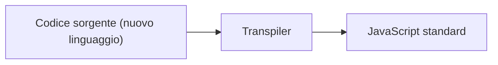

# Lezione 23 TypeScript

## JavaScript e i tipi

### Un sistema di tipi peculiare

JavaScript ha un sistema di tipi **dinamicamente tipizzato**: una stessa variabile può assumere valori di tipo diverso nel tempo.

```js
let x;
console.log(typeof(x)); // undefined
x = 1.25e7;
console.log(typeof(x)); // number
x = "Hello Web Technologies!";
console.log(typeof(x)); // string
```

È anche **debolmente tipizzato** e ama eseguire cast impliciti:

```js
let y = "100" - 1 + "42";
// string - number → number, number + string → string
console.log(`${y}: ${typeof(y)}`); // 9942: string
```

Queste caratteristiche rendono il linguaggio pratico per piccole attività di manipolazione delle pagine web: funziona senza dover essere verbosi, dichiarando tipi o cast espliciti.

### I problemi crescono con la complessità

Man mano che la complessità dei programmi aumenta:

- È più facile introdurre bug subdoli.
- La developer experience peggiora: scarso supporto dell'IDE, pochissimi errori colti nell'IDE e non a runtime.
- Il codice diventa meno manutenibile e difficile da capire.

> [!error] Bug scoperti solo a runtime
> In JavaScript puro errori come invocare qualcosa che non è una funzione (`message()`), sbagliare il nome di una proprietà (`employee.nome` invece di `name`, senza alcun errore) o chiamare un metodo inesistente (`team.add(...)`) emergono solo durante l'esecuzione, se emergono.

Sarebbe utile poter cogliere questi bug prima del runtime.

## Transpiler e TypeScript

### Transpiler

Con l'uso di JS per programmi sempre più complessi, gli sviluppatori hanno sentito il bisogno di colmare questi limiti. JS era però già ampiamente supportato, quindi un nuovo linguaggio non era fattibile: sono nati molti nuovi linguaggi che **compilano verso JavaScript standard** (CoffeeScript, TypeScript, Dart, Elm…). Si scrive codice in un linguaggio con funzionalità aggiuntive, e il codice prodotto può girare ovunque giri JavaScript.



> [!def] TypeScript
> **TypeScript**, nato nel 2012 e progettato e sviluppato da Microsoft (core developer: Anders Hejlsberg), è un **superset di JavaScript** con typing statico e altro, che compila a JavaScript. È di gran lunga il flavor di JS più popolare.

### Installazione e compilazione

TypeScript si installa come pacchetto npm (`npm install -g typescript`): il comando rende disponibile globalmente il compilatore `tsc` (si può usare `npx` o strumenti simili per eseguirlo da un pacchetto locale in `node_modules`). I file TypeScript hanno tipicamente estensione `.ts`.

Il codice JavaScript standard è anche codice TypeScript valido: il compilatore rileva bug anche in JS puro (es. `error TS2554: Expected 2 arguments, but got 1` per una chiamata con argomenti mancanti) e transpila il file `.ts` in un file `.js` eseguibile con Node come al solito.

### Downleveling

`tsc` preserva commenti e indentazione, quindi il codice transpilato sembra scritto da un umano, ma può riscrivere codice da versioni più recenti a versioni più vecchie di JS (**downleveling**): per default TS ha come target ES3 (1999), per esempio trasformando i template string in multiple invocazioni di `.concat()`. Si possono così usare le nuove funzionalità mantenendo la compatibilità anche con vecchi browser che supportano solo ES3. Con `tsc --target es6` si compila verso ES6.

*Vantaggi* :
- Feature moderne accessibili su versioni più vecchie, così facendo non si rinuncia alla retrocompatibilità.

## Dichiarare i tipi

### Tipi primitivi

TS permette di dichiarare i tipi di variabili, parametri e valori di ritorno; i tipi primitivi più comuni sono `string`, `number`, `boolean`.

```ts
let courseName: string = "Web Technologies";
let credits: number = 6;
let isGreat: boolean = true;
```

Il codice con annotazioni di tipo non è più JavaScript valido: per eseguirlo va prima compilato con `tsc`. Il compilatore verifica le assegnazioni: assegnare una string a una variabile `number` è un errore (TS2322, `Type 'string' is not assignable to type 'number'`).

### Tipi di array

Il tipo di un array si specifica con la sintassi `type[]`:

```ts
let langs: string[] = ["TypeScript", "JavaScript", "PHP"];
langs.push({name: "C#"}); // errore in TS, ok in plain JS
```

### Il tipo `any`

> [!def] any
> **`any`** è un tipo speciale: quando un valore è di tipo `any` si può fare qualsiasi cosa con esso e il compilatore non si lamenta, rinunciando a ogni verifica di tipo (con possibili errori a runtime, es. chiamare `x.foo()` su un valore che non ha quel metodo).

### Tipi delle funzioni

TS permette di specificare i tipi sia degli input che dei valori di output delle funzioni:

```ts
function greet(name: string): string {
  return `Hello ${name.toUpperCase()}`;
}
```

Passare un argomento del tipo sbagliato è un errore (TS2345, argomento `number` non assegnabile al parametro `string`).

### Inferenza automatica dei tipi

Quando non è fornita un'annotazione esplicita, TypeScript cerca di inferire automaticamente i tipi dal contesto (es. `let arr = [1,2,3,4,5]` è inferito `number[]`, `let course = "Web Technologies"` è inferito `string`). Nelle versioni moderne di TS l'inferenza automatica di `any` genera un errore (a meno di compilare con l'opzione `--strict false`).

> [!info] Implicit any
> Quando non si specifica un tipo e TypeScript non può inferirlo dal contesto, le versioni vecchie del compilatore assumevano per default `any`, che non è verificato. Il flag `noImplicitAny` segnala come errore ogni implicit `any` (errore TS7006: parametro implicitamente di tipo `any`).

### Tipi oggetto

> [!def] Object type
> Per definire un **object type** si elencano le proprietà dell'oggetto e i loro tipi.

```ts
function printCourse(course: {name: string, credits: number}) {
  console.log(`Course name: ${course.name}`);
}
```

Passare un oggetto privo di una proprietà richiesta è un errore (TS2453, proprietà mancante); passare un object literal con proprietà non previste è un errore (TS2353, proprietà sconosciuta).

### Proprietà opzionali

I tipi oggetto possono specificare una o più **proprietà opzionali** aggiungendo `?` dopo il nome della proprietà: l'oggetto può ometterla, ma il suo valore sarà `undefined`, quindi va gestito (verificare se è `undefined`).

### Union types

> [!def] Union type
> Un **union type** si ottiene combinando due o più tipi, definiti con una lista di tipi separati da `|`, e rappresenta valori che possono appartenere a uno qualsiasi dei tipi combinati.

```ts
function printError(code: number | string) {
  console.log(`Error code: ${code}`);
}
printError(404);
printError("401 Unauthorized");
```

TypeScript garantisce che le operazioni su un union type siano valide per ogni possibile tipo dell'unione: usare `toUpperCase` su `number | string` è un errore (TS2339), perché la proprietà non esiste su `number`.

In questi casi serve **restringere** (narrow) il tipo usando codice e controlli specifici (es. `typeof`, `Array.isArray(x)`): TypeScript inferisce i tipi specifici per i singoli branch.

```ts
function printError(code: number | string) {
  if (typeof code === "string") {
    // in questo branch code è string
  } else {
    // in questo branch code è number
  }
}
```

### Type aliases

> [!def] Type alias
> Un **type alias** assegna un nome specifico a un tipo, per riusare più volte lo stesso tipo senza ripeterne la definizione (principio DRY); la sintassi usa la parola chiave `type`.

```ts
type Credits = number | string;
type Course = {
  name: string,
  credits: Credits
}
```

### Interfacce

> [!def] Interface
> Le **interface declaration** sono un altro modo di dare un nome agli object type.

```ts
interface Course {
  name: string;
  credits: number;
}
```

### Typing strutturale

TypeScript è un linguaggio **structuralmente tipizzato**: per determinare la compatibilità dei tipi si basa solo sulla struttura e sulle capacità dei tipi, non sui loro nomi. Java, al contrario, ha un sistema di tipi **nominativo**. Per questo un oggetto `Pet` con le stesse proprietà di `Person` può essere passato dove è atteso un `Person`.

### Estendere le interfacce

Un'interfaccia può estenderne un'altra con `extends`: le proprietà dell'interfaccia base diventano richieste anche per il tipo derivato (es. `Bird extends Pet` richiede sia `name` sia `flies`).

### Types vs interfaces

Type alias e interfacce sono molto simili e spesso intercambiabili. La distinzione chiave: i **type non possono essere riaperti** per aggiungere nuove proprietà (rideclararli è un errore TS2300, duplicate identifier), mentre le **interfacce sono sempre estendibili** (dichiarazioni successive dello stesso nome si fondono).

### Intersection types

In modo simile agli union types, gli **intersection types** combinano più tipi in uno, creati con il carattere `&`: il tipo risultante ha le proprietà di ogni singolo tipo.

```ts
type Bird = Pet & { flies: boolean }
```

### Type assertions

A volte lo sviluppatore sa più di TypeScript: es. `document.getElementById()` permette di inferire solo che la chiamata restituisce un `HTMLElement`, ma si può sapere che l'elemento è di un tipo più specifico.

```ts
const nameInput =
  document.getElementById("name") as HTMLInputElement;
```

> [!warning] Assertion non enforce a runtime
> La type assertion non è una vera asserzione (come nel testing): non è affatto enforce a runtime, vale solo a compile-time.

### Literal types

Oltre ai tipi `string` e `number` si può fare riferimento a specifiche stringhe e numeri in posizioni di tipo: `let alignment: "center"` accetta solo il valore `center`, cosa poco utile da sola. Combinati con le union esprimono un concetto molto più utile: tipi che corrispondono a un certo insieme di valori noti.

```ts
type Alignment = "center" | "left" | "right";
alignment = "left";  // ok
alignment = "centre"; // errore TS2820
```

### Enum

> [!def] Enum
> Gli **enum** permettono agli sviluppatori di definire un insieme di costanti nominate.

```ts
enum Priority {
  Low,
  Medium,
  High
}
```

I valori sono numerati a partire da 0: `Priority.Medium` vale `1`.

### Function types

Per specificare che una funzione prende in input una callback con parametri e output specifici, le funzioni si descrivono con le **function type expression**:

```ts
type stringDecoratorFunction =
  (x: string, mode: boolean) => string;
```

Il tipo indica una funzione che prende in input una string e un boolean e restituisce una string. Es. `let fn: () => string` è una funzione che non prende argomenti e restituisce una string.

## Generics

### Motivazione

Buona parte dell'ingegneria del software va verso la costruzione di software riutilizzabile: sviluppare componenti capaci di operare senza attrito sia sui dati attuali che su quelli futuri è cruciale per costruire grandi sistemi software. I **generics** sono uno dei principali strumenti per scrivere codice che funziona con una varietà di tipi.

### Il problema della identity function

La identity function restituisce ciò che le viene passato:

- Con `any` è generica, ma si perde l'informazione sul tipo al ritorno (il risultato è `any`).
- Con un tipo specifico (es. `string`) si preserva il tipo, ma funziona solo con le string.

> [!def] Type variable
> TypeScript permette di definire **type variables**, un tipo speciale di variabili che lavorano su tipi anziché su valori, dichiarate dopo il nome della funzione, tra `<` e `>`.

```ts
function identity<Type>(x: Type): Type {
  return x;
}
let s = identity<string>("Hello"); // Type impostato esplicitamente
let n = identity(42);              // inferenza automatica
```

Non è la stessa cosa di usare `any`: l'informazione sul tipo di input è preservata.

### Più type variables e array

Ci possono essere più type variables:

```ts
function merge<T1, T2>(x: T1, y: T2)
  : {field: T2, otherField: T1} {
  return {field: y, otherField: x};
}
```

Si può lavorare anche con array type-parametrici: `function getFirst<T>(arr: T[]): T` restituisce il primo elemento preservandone il tipo.

### Classi generiche

```ts
class CustomCollection<T> {
  list: T[] = [];
  addElement(element: T): number {
    return this.list.push(element);
  }
}
let c = new CustomCollection<string>();
```

### Vincoli di tipo

> [!def] Generic constraint
> Un **vincolo di tipo** con `T extends Animal` limita i tipi ammessi per la type variable ai sottotipi di `Animal`, permettendo di accedere alle proprietà definite in `Animal` (es. `species`).

## void, unknown, never

TS include alcuni tipi aggiuntivi, utili specialmente nel contesto delle funzioni:

- **`void`**: il tipo di ritorno delle funzioni che non restituiscono un valore; è il tipo di ritorno inferito per le funzioni senza istruzione `return` o con `return` vuoto.
- **`unknown`**: rappresenta un qualunque possibile valore; è simile ad `any` ma più sicuro, perché non permette alcuna operazione (errore TS18046, `'a' is of type 'unknown'`, finché il tipo non viene ristretto o si fa un cast).
- **`never`**: rappresenta valori che non vengono mai osservati; es. il tipo di `x` nel ramo irraggiungibile di una funzione che discrimina tutti i casi di un union type, o il tipo di ritorno di funzioni che non ritornano mai perché lanciano sempre un errore.

## Livelli di strictness

Utenti diversi si aspettano cose diverse da TypeScript: per default offre un'esperienza opt-in, con tipi opzionali e `any` usato quando un tipo preciso non può essere inferito. Alcuni controlli sono disabilitati di default per non essere troppo invasivi. Si può essere più severi:

- **`noImplicitAny`**: segnala come errore ogni implicit `any`.
- **`strictNullChecks`**: per default `null` e `undefined` possono essere assegnati a qualunque tipo; dimenticare di gestirli esplicitamente è causa di innumerevoli bug nel mondo (definita da alcuni la *billion dollar mistake*). Il flag impone la gestione esplicita dei valori `null`/`undefined` (es. il risultato di `find` potrebbe essere `undefined`).
- Le versioni moderne di TS abilitano la **strict mode** di default; le versioni più vecchie richiedevano di specificare l'opzione `--strictNullChecks`.