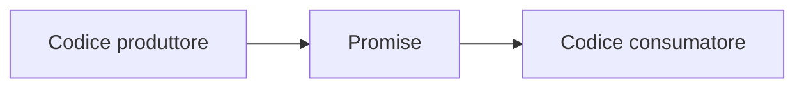
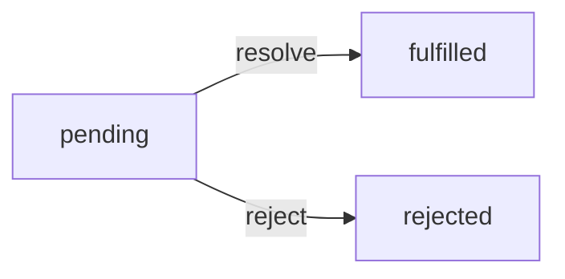
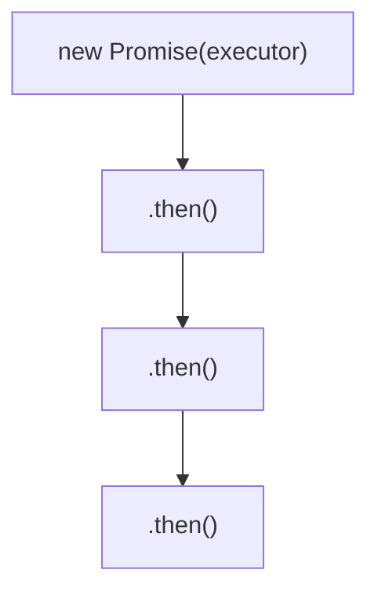

# Lezione 12 JavaScript asincronismo e richieste di rete

## Storage dei dati nel browser

I browser moderni forniscono diverse API, accessibili via JavaScript, per memorizzare e recuperare dati dell'applicazione: **cookie**, **Web Storage** (`localStorage` e `sessionStorage`) e **IndexedDB**.

### Cookie

> [!def] Cookie
> **Piccole stringhe di dati** appartenenti al protocollo HTTP, usate per «superarne» l'assenza di stato (*statelessness*). Vengono tipicamente impostati in una risposta HTTP tramite l'intestazione `Set-Cookie`; il browser li memorizza e li invia in tutte le richieste successive allo stesso dominio, tramite l'intestazione `Cookie` della richiesta.

I cookie del sito corrente sono accessibili da JavaScript tramite la proprietà `document.cookie`.

- Il valore di `document.cookie` è una stringa di coppie `name=value` delimitate da `;`.
- Ogni coppia è un cookie separato.

```js
document.cookie = `name=${name}; max-age=10`; // scade dopo 10 secondi
```

### localStorage

Gestire i cookie via JavaScript non è molto immediato, soprattutto con più cookie: occorre manipolare stringhe, separarle, usare espressioni regolari. L'oggetto `localStorage` fornisce modi semplici per memorizzare coppie chiave/valore nel browser.

- I dati non vengono inviati con ogni richiesta, quindi si possono memorizzare molti più dati.
- È abbastanza simile a una `Map` e può memorizzare solo valori stringa.
- Esiste un oggetto `localStorage` diverso per ogni combinazione di dominio/protocollo/porta.

### sessionStorage

L'oggetto `sessionStorage` fornisce le stesse funzionalità di `localStorage`, ma è usato molto più raramente.

- A differenza di `localStorage`, i cui dati sopravvivono anche a un riavvio completo del browser, `sessionStorage` esiste solo nella scheda corrente del browser.
- I dati sopravvivono al ricaricamento della pagina, ma non alla chiusura e riapertura della scheda.

### IndexedDB

> [!def] IndexedDB
> **Database integrato nel browser**, che supporta diversi tipi di chiave, transazioni e query per intervalli di chiavi (*key-range queries*), e può memorizzare ancora più dati di `localStorage`.

Eccessivamente potente per le tradizionali applicazioni client-server: è pensata soprattutto per le applicazioni offline.

## Sincronismo e asincronismo

### Codice sincrono

Tipicamente il codice JavaScript viene eseguito in modo **sincrono**: ogni istruzione attende il completamento delle precedenti.

- È un modo intuitivo di programmare, ma ha alcuni svantaggi.
- Alcune istruzioni possono richiedere tempo per completarsi: attesa di input dall'utente, attesa del completamento di una richiesta di rete, attesa del termine di un calcolo complesso.
- Le istruzioni successive, anche se importanti, possono rimanere bloccate in attesa: l'**asincronismo** aiuta ad affrontare questi problemi.

### Codice asincrono

L'esecuzione di JavaScript è ordinariamente **single-threaded**: è il browser a fornire le capacità asincrone, come i timer e le richieste di rete.

JavaScript esegue le callback quando può, una volta completate le operazioni pertinenti.

```js
console.log("A");
setTimeout(() => { console.log("B"); }, 2000); // dopo 2000 ms
console.log("C"); // l'output è "A", "C" e infine "B"
```

### Callback

> [!def] Callback
> **Funzioni passate come argomenti** ad altre funzioni, con l'aspettativa che vengano invocate al momento appropriato. I gestori di eventi (*event handler*) sono infatti callback.

### Limiti delle callback

Quando si gestiscono molte callback annidate dentro altre callback, il codice diventa molto disordinato molto rapidamente, e la gestione degli errori lo complica ulteriormente.

```js
firstOperation(result, (r1) => {
  secondOperation(r1, (r2) => {
    thirdOperation(r2, (r3) => { console.log(r3); });
  });
});
```

- Per questo si parla di **Callback Hell** o *Pyramid of Doom*.
- Il vecchio JavaScript gestiva l'asincronismo con le callback; in quello moderno si usa tipicamente un nuovo costrutto: la **Promise**.

## Promise

### Produttore e consumatore

In programmazione capita spesso che esistano un codice **produttore**, che fa qualcosa che richiede tempo (attende input dell'utente, scarica dati dalla rete, esegue calcoli complessi), e un codice **consumatore**, che ha bisogno dei risultati del produttore.

> [!def] Promise
> **Costrutto del JavaScript moderno** che serve a collegare produttori e consumatori.



### Creazione di una Promise

Un oggetto `Promise` si crea con l'apposito costruttore, passando come argomento l'**executor**: la funzione viene invocata immediatamente, appena la Promise viene creata.

- `resolve` e `reject` sono callback fornite da JavaScript.
- Quando il codice dell'executor termina, deve chiamare una delle due.
- `resolve(value)`: se l'operazione è completata con successo, con risultato `value`.
- `reject(error)`: se si è verificato un errore, con l'oggetto errore `error`.

```js
let promise = new Promise(function(resolve, reject) {
  // executor: qui il codice produttore
});
```

### Ciclo di vita

Una Promise nasce nello stato **pending**; quando viene stabilita (*settled*) diventa **fulfilled** (mantenuta) oppure **rejected** (rifiutata).



```js
console.log(promise); // Promise { <state>: "pending" }
```

### then

Il codice consumatore riceve una Promise che certi dati saranno resi disponibili in un certo momento del futuro, e registra le azioni da eseguire tramite metodi specifici offerti dall'oggetto Promise; il più importante è `.then()`.

- `.then()` prende in input due callback: la prima è invocata quando la Promise è mantenuta, la seconda quando è rifiutata.
- È anche possibile registrare solo la funzione da eseguire in caso di Promise mantenuta.

```js
promise.then(
  (result) => { /* Promise mantenuta */ },
  (error) => { /* Promise rifiutata */ }
);
```

### catch

Quando interessano solo gli scenari di errore, si può passare `null` come primo argomento di `.then()`, oppure usare il metodo equivalente `.catch()`.

```js
promise.catch((error) => { /* Promise rifiutata */ });
```

### finally

Come i blocchi `try/catch`, anche le Promise offrono un metodo `.finally()`, che prende una callback senza input.

- È invocato appena la Promise si stabilisce, sia con `resolve` sia con `reject`.
- È pensato per eseguire pulizie (*clean-up*) e altre operazioni da svolgere a prescindere dallo stato della Promise.

### Chaining

Quando serve eseguire una sequenza di passaggi asincroni si usa il **concatenamento** (*chaining*) delle Promise: la Promise originale viene risolta una sola volta, ma ogni invocazione di `.then()` restituisce in realtà una nuova Promise, che rappresenta il completamento del gestore stesso.

- Quando un gestore restituisce un valore, questo diventa il risultato della nuova Promise.
- Un `throw` all'interno di un gestore equivale a una `reject()` implicita.



```js
promise
  .then((r) => { console.log(r); return r * 2; }) // 1
  .then((r) => { console.log(r); return r * 2; }) // 2
  .then((r) => { console.log(r); return r * 2; }); // 4
```

> [!error] Concatenamento errato
> Chiamare più volte `.then()` sulla stessa Promise non è concatenamento: ogni gestore riceve il risultato della Promise originale, non il valore restituito dal gestore precedente.
>
> ```js
> // con risultato originale 1: stampa 1, 1, 1
> promise.then((r) => { console.log(r); return r * 2; });
> promise.then((r) => { console.log(r); return r * 2; });
> ```

### Metodi statici dell'API Promise

L'oggetto `Promise` espone anche metodi statici per lavorare con più Promise contemporaneamente.

- **`Promise.all(array)`**: restituisce una nuova Promise che rappresenta il completamento di tutte le Promise di ingresso; il risultato è un array in cui ogni Promise di ingresso contribuisce un elemento; se una sola Promise viene rifiutata, `Promise.all` si rifiuta immediatamente.
- **`Promise.allSettled(array)`**: aspetta che tutte le Promise di ingresso si stabilizzano, ma restituisce come risultato un array di oggetti che rappresentano lo stato di ciascuna (`status: "fulfilled"` con `value`, oppure `status: "rejected"` con `reason`).
- **`Promise.race(array)`**: simile a `Promise.all()`, ma si stabilisce appena una delle Promise di ingresso si stabilizza, e ne assume il risultato o l'errore.
- **`Promise.any(array)`**: simile a `Promise.race()`, ma attende la prima Promise risolta; se tutte le Promise di ingresso vengono rifiutate, si rifiuta con un `AggregateError` contenente tutti gli errori.
- **`Promise.resolve(value)`** e **`Promise.reject(error)`**: creano Promise già stabilite (rispettivamente risolta o rifiutata); a volte sono usate per compatibilità, ad esempio quando una funzione è attesa che restituisca una Promise.

```js
Promise.all([
  new Promise(res => setTimeout(() => res(3), 3000)),
  new Promise(res => setTimeout(() => res(2), 2000)),
  new Promise(res => setTimeout(() => res(1), 1000)),
]).then((result) => console.log(result)); // [3, 2, 1]
```

## async e await

Il JavaScript moderno include una sintassi speciale per lavorare con le Promise, composta da due parole chiave: `async` e `await`.

### async

La parola chiave `async`, posta prima di una funzione, garantisce che la funzione restituisca sempre una Promise.

- Qualsiasi altro valore restituito da una funzione `async` viene implicitamente incapsulato in una Promise risolta.
- Gli errori lanciati vengono incapsulati in una Promise rifiutata.

```js
async function g() {
  return 1; // equivale a restituire Promise.resolve(1)
}
```

### await

La parola chiave `await` si può usare solo all'interno di funzioni `async`, e mette in pausa l'esecuzione del codice finché una Promise non si stabilisce.

```js
async function f() {
  let promise = new Promise((res) => setTimeout(() => res("Done"), 2000));
  let result = await promise; // l'esecuzione si mette in pausa qui
  return result;
}
```

## Richieste di rete

JavaScript può anche scaricare dati da Internet.

### XMLHttpRequest

Nel vecchio JavaScript i programmatori usavano oggetti `XMLHttpRequest`, con callback per gestire gli eventi di stato.

### fetch

> [!def] `fetch()`
> **Modo moderno di eseguire richieste HTTP** in JavaScript: prende in ingresso un URL e un array opzionale di opzioni, e restituisce una Promise che si risolve in un oggetto `Response`.

```js
let promise = fetch("url", [options]);
```

Le opzioni permettono di specificare metodo HTTP, intestazioni della richiesta, eccetera.

### Lavorare con la risposta

> [!warning] Risoluzione anticipata
> La Promise restituita da `fetch()` si risolve appena arrivano le intestazioni della risposta: in quel momento si possono controllare stato e intestazioni HTTP, ma il corpo della risposta potrebbe non essere ancora disponibile.

Sull'oggetto `Response` si possono controllare stato e intestazioni.

- `response.status` contiene il codice di stato HTTP.
- `response.ok` indica se la richiesta ha avuto successo.
- `response.headers.get('Content-Type')` legge una specifica intestazione; le intestazioni della risposta sono iterabili.

```js
let response = await fetch("./example.json");
console.log(response.headers.get('Content-Type'));
if (response.ok) { /* richiesta riuscita */ } else { /* errore */ }
```

### Corpo della risposta

L'oggetto `Response` fornisce diversi metodi basati su Promise per accedere al corpo in vari formati, non appena diventa disponibile: ad esempio `.json()` interpreta il corpo come JSON.

| Metodo | Risultato |
| --- | --- |
| `.text()` | Legge il corpo della risposta e lo restituisce come testo |
| `.json()` | Interpreta il corpo della risposta come JSON |
| `.blob()` | Restituisce un Blob (dati binari con tipo) |
| `.arrayBuffer()` | Restituisce un ArrayBuffer (rappresentazione binaria di basso livello) |
| `formData()` | Restituisce un FormData (dati inviati tramite form) |

```js
let response = await fetch("https://catfact.ninja/fact");
if (response.ok) {
  let fact = await response.json(); // corpo interpretato come JSON
}
```

> [!warning] Corpo consumabile una sola volta
> Si può scegliere **un solo** metodo di lettura del corpo: se è già stato chiamato `response.text()`, `response.json()` non funziona perché il contenuto del corpo è già stato consumato.