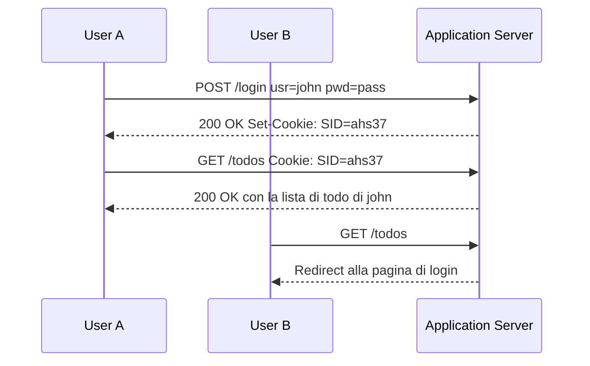

# Lezione 17 Sessioni in Node.js

## HTTP e session tracking

Il protocollo HTTP, per come funziona «out of the box», non permette a un server di ricordare nulla delle richieste precedenti.

> [!def] HTTP stateless
> **Protocollo stateless**: una singola richiesta HTTP non contiene, di per sé, alcuna informazione sulle richieste precedenti. Senza meccanismi aggiuntivi il server non può sapere che un dato utente ha già effettuato il login.

> [!def] Session tracking
> **Tecnica** cruciale dello sviluppo web che consiste nel mantenere informazioni di stato (*stateful*) sulle interazioni di un utente attraverso richieste HTTP multiple. Permette al server di «riconoscere» gli utenti e le loro azioni, così da adattare le risposte a utenti e situazioni differenti.

## Sessioni basate su cookie

Un primo modo per far «memorizzare» dati al server tra richieste diverse è impostare **cookie**. L'idea dell'approccio ingenuo (*naive*) è la seguente.

1. L'utente invia una richiesta a una pagina dinamica con username e password come parametri.
2. La pagina verifica le credenziali: se corrette, il server imposta cookie di tracciamento (es. `Set-Cookie: auth=true;username=luigi`); se errate, mostra una pagina di errore senza impostare alcun cookie.
3. Le pagine dinamiche che richiedono autenticazione controllano il cookie `auth`: se è impostato mostrano il contenuto, altrimenti reindirizzano alla pagina di login.

### Gestione della richiesta di login

Il login avviene con un form con campi `usr` e `pwd` via `POST`: il server parsifica il corpo della richiesta e controlla le credenziali. Se sono corrette, reindirizza a `/` con codice `302` e imposta due cookie, uno con lo username e l'altro con un valore booleano, entrambi con scadenza di 1 ora.

```js
if (isAuthenticated) {
  response.writeHead(302, {
    "Location": "/",
    "Set-Cookie": [
      `auth=true; max-age=${60*60}`,
      `username=${user.username}; max-age=${60*60}`
    ]
  });
  response.end();
}
```

Se le credenziali non sono corrette, il server rende la pagina di login con un messaggio di errore e risponde con il codice `401` (Unauthorized).

### Verifica dell'autenticazione

Le richieste vanno gestite diversamente a seconda che l'utente sia autenticato o meno: un utente non autenticato che visita una rotta protetta riceve una pagina di errore con `401`, mentre un utente autenticato vede il contenuto riservato. Lo stato si verifica controllando i cookie presenti nella richiesta HTTP.

```js
function checkUserAuthentication(request) {
  let cookies = parseCookies(request);
  if (cookies.auth) return [true, cookies.username];
  return [false, undefined];
}
```

Node.js non offre un parser di cookie, quindi va scritto a mano: l'intestazione `Cookie` si spezza sul separatore `;` e ogni cookie sul carattere `=`, avendo cura di applicare `trim` e `decodeURIComponent` ai valori.

```js
function parseCookies(request) {
  const list = {};
  const header = request.headers?.cookie;
  header?.split(';').forEach(cookie => {
    const [name, ...rest] = cookie.split('=');
    list[name?.trim()] = decodeURIComponent(rest.join('=').trim());
  });
  return list;
}
```

### Propagazione del contesto di autenticazione

Lo stato di autenticazione influenza tutte le pagine dell'app, per esempio la navbar che mostra «Welcome, User» al posto di «Login». L'informazione va quindi resa disponibile a tutti i controller: il metodo `handleRequest` calcola una volta sola lo stato e lo passa ai gestori delle rotte dentro un oggetto `context` con i campi `isUserAuthenticated` e `username`. Ogni gestore di rotta controlla `context.isUserAuthenticated` e risponde con `401` se l'utente non è autenticato; solo in caso contrario instrada la richiesta in base al metodo HTTP, rispondendo `405` per i metodi non supportati.

## Limiti dell'approccio con cookie

L'approccio a cookie funziona ed è semplice da implementare, ma soffre di problemi critici.

> [!warning] Cookie controllati dal client
> I cookie sono interamente controllati dal client ed è banale manometterli, il che rende di fatto inutile l'autenticazione basata su di essi.
> - Un utente può cambiare a piacere il valore del cookie `username`, oppure impostarlo da solo senza mai visitare la pagina di login.
> - Il problema del *tampering* si può affrontare con **cookie firmati** (*signed cookies*): il server firma i cookie con la propria chiave privata e, finché la chiave resta sicura, riconosce i cookie manomessi.

> [!info] Limiti imposti dai browser
> I browser impongono limitazioni ai cookie per evitare problemi di prestazioni.
> - **Dimensione**: un cookie è generalmente limitato a 4096 byte.
> - **Quantità**: si possono memorizzare generalmente da 20 a 50 cookie per dominio.
> - Se i dati di sessione da memorizzare superano questi limiti, i cookie non bastano.

## Sessioni lato server

Per tracciare informazioni sensibili delle interazioni precedenti mitigando il *tampering*, e per memorizzare più dati di quanti i cookie consentano, si usa il meccanismo di **sessione web** (RFC 6265).

> [!def] Sessione web
> **Struttura dati** che memorizza coppie chiave-valore, gestita e archiviata sul server: quando serve mantenere informazioni tra richieste, il server crea una sessione per un dato client. La sessione è identificata da un unico **session id** (o *session token*), passato al client generalmente come cookie.

La conseguenza chiave è che i dati di sessione restano sul server e il client non può manipolarli.

### Esempio di autenticazione con sessioni

Il server mantiene una sessione separata per ogni client, identificata dal proprio session id e contenente coppie chiave-valore come `auth = true` e `username = john`. Il flusso tipico è il seguente.



### Implementazione da zero in Node.js

Un meccanismo di sessione di base si implementa facilmente con i `Map` nativi di JavaScript: una prima `Map` associa ogni session id a una sessione, che a sua volta è una `Map` di coppie `<chiave, valore>`.

```js
class Session {
  constructor() { this.sessionStore = new Map(); }
  createSession() {
    let sessionId = this.generateNewSessionId();
    this.sessionStore.set(sessionId, new Map());
    return sessionId;
  }
  storeSessionData(sessionId, key, value) {
    return this.getSessionById(sessionId)?.set(key, value);
  }
}
```

Quando un utente effettua il login si crea una nuova sessione, vi si memorizzano i dati rilevanti e si passa il session id al client come cookie.

```js
if (isAuthenticated) {
  let sessionId = session.createSession();
  session.storeSessionData(sessionId, "username", user.username);
  session.storeSessionData(sessionId, "auth", true);
  response.writeHead(302, {
    "Location": "/",
    "Set-Cookie": [`sessionId=${sessionId}; max-age=${60*60}`]
  });
  response.end();
}
```

Per accedere ai dati di sessione a ogni richiesta, il metodo `getSessionFromRequest` legge il cookie `sessionId` tramite `parseCookies` e recupera la sessione corrispondente con `getSessionById`; i valori si leggono poi con `userSession?.get("auth")` e `userSession?.get("username")` e finiscono nel `context` condiviso dai controller.

### Metodi di session tracking

L'uso di un cookie per trasportare il session id è l'approccio più popolare perché semplice e ampiamente supportato, ma esistono alternative.

- **URL rewriting**: il session id viene aggiunto a ogni URL come parametro di query.
- **Campi form nascosti** (*hidden form fields*): il session id è memorizzato in campi nascosti dei form e viene inviato insieme agli altri dati quando l'utente sottomette il form.
