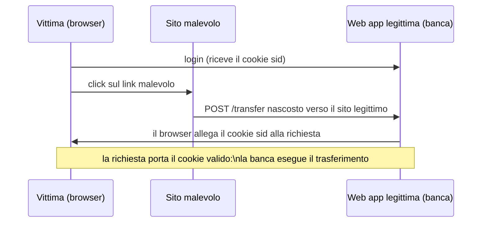

# Lezione 22 Web App Security

## Sicurezza delle web app

> [!def] Web Application Security
> **Insieme di misure e pratiche** implementate per proteggere le web application dalle minacce di sicurezza, con l'obiettivo di garantire la **confidentiality**, l'**integrity** e la **availability** dell'applicazione e dei dati che gestisce.

La sicurezza va gestita a due livelli:

- **Network-level**: riguarda la comunicazione tra web app e Internet — cifratura del traffico (HTTPS), firewall che filtrano richieste HTTP malevole, monitoraggio e logging per rilevare pattern sospetti.
- **Application-level**: riguarda i meccanismi interni della web app — autenticazione e autorizzazione, validazione degli input per l'integrità dei dati, gestione delle sessioni, riservatezza dei dati.

Il livello network protegge da attacchi al livello di rete (es. sniffing, man-in-the-middle, DDoS filtrati da un firewall); gli attacchi applicativi invece possono nascondersi in richieste HTTP perfettamente valide ed exploitare vulnerabilità nel modo in cui l'app è implementata. Nel corso ci si concentra sul livello applicativo, facendo sì che le app sviluppate non contengano vulnerabilità, e sui meccanismi di sicurezza dei browser (es. CORS).

### La catena dello stack moderno

Una web app moderna è molto più del codice che si scrive: è un'intera pila, dove ogni anello può introdurre vulnerabilità — dal proprio codice al codice di terze parti, al framework, al runtime (es. Node, PHP), al sistema operativo, all'hypervisor, fino all'hardware.

> [!info] L'anello più debole
> Una web app è sicura solo quanto il suo anello più debole: una RCE nel template engine EJS o in PHP, un open redirect in Express, una vulnerabilità nel kernel Linux o nell'hypervisor possono compromettere tutta l'app.

Le pratiche di igiene di sicurezza che ne derivano:

- Prestare attenzione agli **advisory di sicurezza**.
- Usare solo librerie e framework **affidabili e mantenuti**.
- Mantenere tutto **aggiornato**.
- **Disabilitare** ogni servizio non strettamente necessario.
- Applicare il **principle of least privilege**: ogni modulo deve accedere solo alle informazioni strettamente necessarie al suo scopo.

> [!info] OWASP
> L'**Open Worldwide Application Security Project** è un'organizzazione non profit che raccoglie dati sulle vulnerabilità e pubblica report periodici sulle classi di vulnerabilità più diffuse (**OWASP Top 10**); una quota significativa delle web app ne contiene almeno una.

Le vulnerabilità trattate nel seguito sono frequenti, molto dannose e facilmente prevenibili: XSS, CSRF, SQL injection, attacchi alle sessioni, validazione degli input insufficiente.

## Cross-Site Scripting (XSS)

> [!def] Cross-Site Scripting (XSS)
> **Attacco** che inietta codice client-side malevolo in siti altrimenti fidati, exploitando falle dell'app che mostra input non fidato (es. di altri utenti) senza validazione o escaping adeguati.

Il codice iniettato è eseguito dal browser come se fosse codice fidato: è indistinguibile dal JavaScript legittimo della pagina.

Le conseguenze: l'utente può essere attaccato semplicemente cliccando un link malevolo, e il codice iniettato può fare tutto ciò che il JavaScript fidato può fare:

- Accedere e manipolare i cookie (es. gli id di sessione).
- Accedere a `localStorage` e `sessionStorage` (es. token o dati privati).
- Manipolare la pagina (alterare link e form, aggiungere contenuto).
- Generare eventi e compiere azioni come l'utente (es. submit di form).

> [!warning] I filtri non bastano
> Filtrare l'input (es. rimuovere `<script>` o i caratteri `<` e `>`) è aggirabile: esistono dedicate **tecniche di filter evasion** (es. `<iframe src="javascript:...">`, tab e caratteri codificati dentro `javascript:`, attributi `onerror` con entità numeriche). Sulla falsariga, l'OWASP pubblica un cheat sheet di evasione dei filtri.

Per esfiltrare un token dalla vitttima, il codice iniettato può redirigere la finestra (o un iframe) verso un URL malevolo, aggiungere un'immagine o caricare un foglio di stile il cui URL contiene il dato rubato (alcuni browser bloccano l'immagine, ma non tutte le vie).

> [!def] Escaping / sanitizzazione
> **Contromisura** fondamentale contro XSS: convertire i caratteri pericolosi (`<`, `>`, `"`, …) in **HTML entity** innocue (es. `&lt;script&gt;`) al momento dell'inserimento dell'input nelle pagine; esistono soluzioni dedicate nei framework e librerie apposite (es. `sanitize` per Node.js). Non affidarsi ai soli filtri.

### XSS in Angular

Angular **sanitizza automaticamente** ogni dato non fidato interpolato o collegato nei template; per default tutti i dati sono non fidati.

> [!warning] `DomSanitizer` bypassa la protezione
> Marcare dati come fidati con `DomSanitizer` (es. `bypassSecurityTrustHtml(value)`) disattiva le contromisure predefinite e va fatto con cautela: nel codice, l'errore XSS era causato proprio da un `bypassSecurityTrustHtml` su un query param non fidato.

## Cross-Site Request Forgery (CSRF)

> [!def] Cross-Site Request Forgery (CSRF o XSRF)
> **Attacco** che spinge un utente finale a eseguire azioni non volute su una web app su cui è attualmente autenticato.

Le azioni mirate sono operazioni che cambiano lo stato (es. trasferimenti di fondi, cambio email dell'account); se la vittima ha privilegi amministrativi, l'attacco può compromettere l'intera applicazione.



Il meccanismo sfruta il fatto che il browser della vittmma **allega automaticamente il cookie di autenticazione** alle richieste verso il sito legittimo, anche se partono da una pagina di un sito malevolo (es. un form `POST` nascosto che punta a `https://bank.com/transfer`, sottomesso automaticamente via JavaScript).

> [!def] Synchronizer token pattern
> **Contromisura** contro il CSRF: la web app genera un **CSRF token** specifico della sessione e lo salva nella sessione; il token è incluso in un campo nascosto dei form sensibili; alla sottomissione l'app verifica che il token ricevuto combaci con quello generato per la sessione corrente. L'attaccante non può indovinarlo.

Il token-based approach funziona purché:

- Non esistano vulnerabilità XSS (che permetterebbero di leggere il token).
- I token CSRF non siano predicibili.

La protezione CSRF è inclusa in molti strumenti: middleware per Express (es. `tiny-csrf`), contromisure in Angular, protezione dei `POST` di Spring attiva di default. Se il framework la offre, va letta la documentazione per usarla correttamente; altrimenti va implementata per le operazioni sensibili.

## SQL injection

> [!def] SQL injection
> **Attacco** che inietta codice malevolo nelle query al database tramite input utente non sanitizzato; nonostante il nome, anche le query sui database NoSQL possono essere ugualmente vulnerabili.

Le conseguenze possibili: leak di dati privati, modifica (create, update, delete) dei dati, violazioni del controllo d'accesso e, in alcuni casi, esecuzione arbitraria di codice sul server del database.

La vulnerabilità nasce quando i parametri della richiesta vengono inseriti **direttamente nella stringa SQL**: l'attaccante può alterare la struttura della query stessa. Con l'email `luigi@webtech-sh.op' --` la query di login diventa:

```sql
SELECT * FROM Users
WHERE email = 'luigi@webtech-sh.op' --' AND password = '...' AND deletedAt IS NULL
```

In SQL il `--` inizia un commento su riga singola: il controllo sulla password viene commentato via e l'autenticazione è aggirata.

> [!def] Prepared statements
> **Contromisura** contro le SQL injection: query con **parametri** (`$1`, `$2`, …) in cui i valori sono passati separatamente (es. con `bind`) e non vengono mai interpretati come parte della struttura della query; in alternativa si usano stored procedure.

```js
models.sequelize.query(
  'SELECT * FROM Users WHERE email = $1 AND password = $2',
  { bind: [ req.body.email, security.hash(req.body.password) ] }
);
```

## Session hijacking

> [!def] Session hijacking
> **Classe di attacchi** volta a compromettere il token di sessione, tipicamente rubando un token valido o predidendone uno.

Le app vulnerabili a XSS sono una via tipica per il furto del token di sessione, che permette all'attaccante di impersonare la vittmma.

## Validazione degli input

Una corretta **input validation** è gran parte dell'integrità dei dati in una web app.

- La validazione **client-side** è una buona pratica per l'usabilità: gli errori sono presentati all'utente il prima possibile.
- Ma un attaccante può **aggirarla del tutto**: può accedere al codice client e manipolarlo, o generare richieste HTTP direttamente.

> [!warning] Validare sempre anche lato server
> La validazione client-side serve all'esperienza utente, non alla sicurezza: la validazione deve essere sempre eseguita anche, e soprattutto, server-side.

## Il modello di sicurezza dei browser

I browser moderni applicano un modello di sicurezza severo, di cui lo sviluppatore web deve conoscere i meccanismi per lavorarci. Il principale è la **Same-origin Policy**.

> [!def] Same-origin Policy (SOP)
> **Politica** per cui, di default, un documento o uno script può interagire solo con risorse della **stessa origine**, cioè con lo stesso protocollo, la stessa porta e lo stesso host.

Rispetto al documento `http://store.webtech.com/cat/index.html`:

| URL | Stessa origine? | Motivo |
|---|---|---|
| `http://store.webtech.com/pages/about.html` | Sì | Differisce solo il path |
| `https://store.webtech.com/page.html` | No | Protocollo diverso |
| `http://store.webtech.com:81/dir/page.html` | No | Porta diversa (`http` usa di default la 80) |
| `http://course.webtech.com/cat/index.html` | No | Host diverso |

La policy si applica ai dati recuperati via JavaScript con `fetch()` o `XMLHttpRequest`, con lievi differenze tra browser.

### CORS

A volte serve accedere a contenuti di origini diverse dalla propria.

> [!def] Cross-Origin Resource Sharing (CORS)
> **Meccanismo** che permette a un server di fare "opt-out" della Same-origin Policy, dichiarando — tramite header dedicati nelle risposte — che il proprio contenuto è accessibile anche da origini diverse dalla sua.

Il meccanismo è **header-based**:

- Il browser allega alle richieste `fetch` in uscita un header **`Origin`** con l'origine della pagina.
- Il server include nella risposta un header **`Access-Control-Allow-Origin`** che specifica quali origini possono usare i dati: `*` significa "qualsiasi origine", oppure un'origine precisa, es. `http://localhost:3001`.
- Senza header, il default è che le richieste cross-origin sono **proibite**.
- Il browser verifica che `Access-Control-Allow-Origin` combaci con `Origin`: in caso positivo il codice client accede ai dati, altrimenti la richiesta è bloccata.