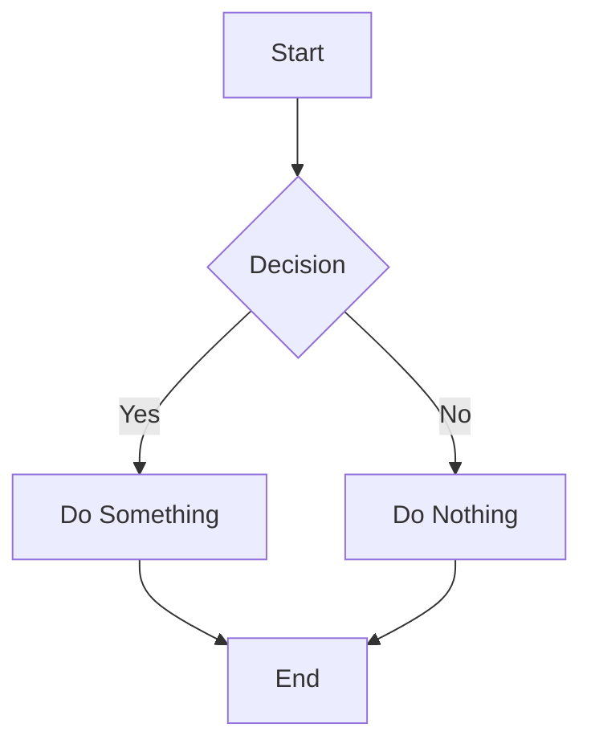
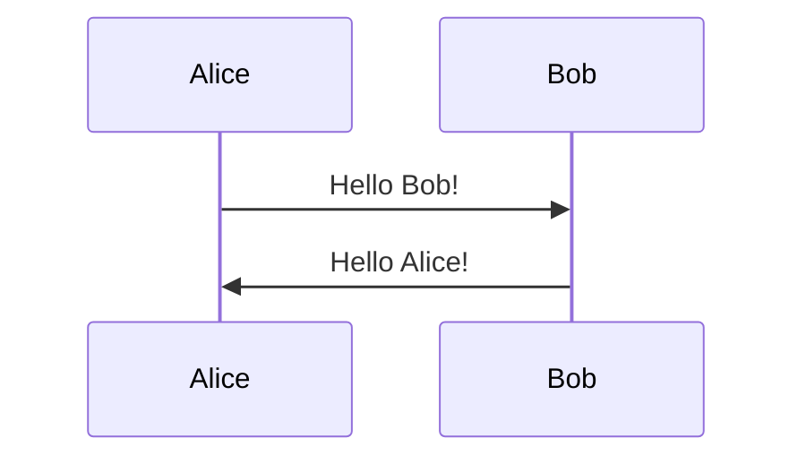

# Argomento o Lezione #
## Sezione ##
### Sotto-Sezione ###
#### Sotto-Sotto-Sezione ####

## Callout

- **Definizione senza titolo**
> [!def]
> Contenuto della definizione senza titolo.

- **Definizione con titolo**
> [!def] Titolo della definizione
> Contenuto della definizione con titolo.

- **Info**
> [!info]
> Contenuto informativo.

> [!info] Titolo info
> Contenuto informativo con titolo.

- **Example**
> [!example]
> Contenuto dell'esempio.

> [!example] Titolo esempio
> Contenuto dell'esempio con titolo.

- **Warning**
> [!warning]
> Attenzione: contenuto di avvertimento.

> [!warning] Attenzione
> Testo di avvertimento con titolo.

- **Error**
> [!error]
> Errore: contenuto di errore.

> [!error] Titolo errore
> Descrizione dell'errore con titolo.

- **Lab**
> [!lab]
> Contenuto di laboratorio e/o argomenti pratici.

> [!lab] Titolo laboratorio
> Descrizione del laboratorio con titolo.

- **Aside** (testo + logo a destra)
> [!aside]
> Contenuto testuale a sinistra.
>
> ---
> ![[aside.png|100]]

## Codice

### Inline
Codice `inline` in una frase.

### Blocco (con e senza linguaggio)
```bash
#!/bin/bash
echo "Hello, World!"
```

```python
def hello():
    print("Hello, World!")
```

```javascript
console.log("Hello, World!");
```

### Blocco con titolo
```bash [Title: Script di esempio]
#!/bin/bash
echo "Script con titolo"
```

## Mermaid

### Diagramma di flusso


### Diagramma di sequenza


## Tabelle

| Intestazione 1 | Intestazione 2 | Intestazione 3 |
|---------------|---------------|---------------|
| Riga 1, Col 1 | Riga 1, Col 2 | Riga 1, Col 3 |
| Riga 2, Col 1 | Riga 2, Col 2 | Riga 2, Col 3 |

| Allineato a sinistra | Allineato al centro | Allineato a destra |
|:------------------|:-----------------:|------------------:|
| Testo             | Testo             | Testo            |

## Matematica

Matematica inline: $E = mc^2$, $\frac{a}{b}$, $\sum_{i=1}^n i$.

Matematica in blocco:
$$
\int_0^\infty e^{-x^2} \, dx = \frac{\sqrt{\pi}}{2}
$$

$$
\begin{aligned}
  (a + b)^2 &= a^2 + 2ab + b^2 \\
  (a - b)^2 &= a^2 - 2ab + b^2
\end{aligned}
$$

## Citazioni

> Questa è una citazione semplice.

> [!quote] Autore famoso
> Testo della citazione con autore.


## Liste

### Non ordinate
- Elemento 1
- Elemento 2
  - Sott-elemento 2.1
  - Sott-elemento 2.2
- Elemento 3

### Ordinate
1. Primo elemento
2. Secondo elemento
   1. Sott-elemento 2.1
   2. Sott-elemento 2.2
3. Terzo elemento

### Todo/Task list
- [x] Completato
- [ ] Da fare
- [ ] Altro da fare

## Link

[Testo del link](https://www.esempio.com)

<https://www.esempio.com> (link nudo)

## Immagini


![[logo.png|300]]

## Testo formattato

**Grassetto**

*Corsivo*

***Grassetto e corsivo***

~~Barrato~~

==Evidenziato==

`Codice inline`

## Note a piè di pagina

Testo con nota a piè di pagina[^1].

[^1]: Contenuto della nota a piè di pagina.

## Linee orizzontali

3 caratteri "-"

---

3 caratteri "*"

***

3 caratteri "_"

___
